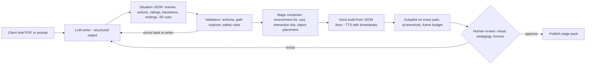

# AI Integration

## 1. Verdict

**No verified runtime AI integration was found in the current implementation.**

- None of the game pages or modules (`fp-extinguisher/*.html`, `fp-extinguisher/aq01/*.js`, `pumpjack*/*.html`) calls an AI model or AI API.
- A case-insensitive search for `elevenlabs`, `openai`, `anthropic`, `api.`, `huggingface` and `xi-api-key` found only these matches:
  - two code comments saying the voice files were made offline: `saf01.html:1140`, `agr03.html:782`;
  - a label on the listening page: `voice-samples.html:3`.

AI was used **at development time only**, as described below.

---

## 2. Development-time AI usage (verified)

| Use | Tool / model | How it was verified | What it produced |
|---|---|---|---|
| Writing the application code | **Claude Code** (Anthropic CLI agent). Main model `claude-opus-5-5`; some subagents ran on `claude-sonnet-5-5` or `claude-haiku-5-5`. | Claude Code session transcripts under the developer's user profile (`.claude/projects/c--book/*.jsonl`) | All HTML/JS of the demos, the build script `scenarios/saf01/build_saf01.py`, the tools in `fp-extinguisher/tools/`, and the offline scripts listed in §4 |
| Multi-agent research and review | Claude Code subagents and scripted workflows | Same transcripts (about 18 subagent calls, 5 workflow runs) | Subagents built the first SAF-01 scenario file, the photoreal farm shed, character and scan builds, and `aq01/people.js` / `aq01/audio.js`. Workflows ran the pen-grip research, the tripod grip solver, the writing-camera and ink reviews, and the speed/intro review. |
| Voice lines | **ElevenLabs Text-to-Speech**, model `eleven_v3`, endpoint `/v1/text-to-speech/{voice}/with-timestamps` | `assets/audio/{agr03,saf01}/manifest.json` (`"model": "eleven_v3"`), `gen_lines.py` | 83 MP3 files with per-letter timing JSON (AGR-03: 40 lines, 163.8 s; SAF-01: 43 lines, 111.8 s) |
| Pronunciation check (attempted) | ElevenLabs speech-to-text | `stt_check.py` | **Not working**: the API key lacks the permission |

**Verified as NOT AI-generated:**
- 3D models and textures: Rocketbox, Poly Haven, Renderpeople, or procedural code.
- Animations: Rocketbox motion capture plus procedural IK.
- Environments: procedural code.
- `grip/tripod.json`: a numerical optimiser (CMA-ES), not an AI model.

**No generative image, video or 3D model was used for the shipped demos.**

There is one exception, which is experimental and never deployed. The `?karim=scan` option in SAF-01, and the R&D pages, use research body scans from `assets/fullbody/`. An AI tool (LHM) rebuilt those bodies from AI-generated images (`Gsplat-unity-virtual-human/README.md`). Their licence is research-only, and `sync_deploy.py` keeps them out of every deploy.

---

## 3. Prompts

### 3.1 Prompts that started each demo

Translated from Egyptian Arabic. Taken from the development transcripts.

| Demo | Prompt (English) | Inputs attached |
|---|---|---|
| Machine explorer | "I want to make a site like this video: interactive, the user controls everything with clicks … every 3D asset controllable … buttons at the bottom and cards for the parts. Also write a .md file with all the details, as a reference for any agent when I give it the idea." | Reference video, machine photo |
| Extinguisher Drill | "I want the hand to appear like this and make the movement I want." | Reference image, a plan PDF |
| SAF-01 | "Do this scenario with the hands and characters we have, and the environment, in a new file." | Client PDF *Situation SAF-01 The Wrong Extinguisher* |
| AGR-03 | "Start implementing this the same way as last time, and if we ran into something last time, fix it here." | Client brief AGR-03 |
| AQ-01 | "Can we make something more realistic than this?", then "Start." | Client script *Still in Lane 4* |

### 3.2 Iteration prompts that worked well

These prompts name a reference and a specific failure:
- "Hands like in the fire one: real, natural movement."
- "When he wants to take notes he takes out a notebook and writes."
- A YouTube link given as "the correct pen-grip reference".
- "His hand goes into the pot. It should wrap around the outside like a person would."

### 3.3 Prompt template in the workspace

`INTERACTIVE_3D_MACHINE_SPEC.md` is a 26 KB build specification addressed to AI agents. Its §15 is the template:

> Build an interactive 3D explorer of **&lt;MACHINE&gt;** following `INTERACTIVE_3D_MACHINE_SPEC.md`. Reference implementation: `pumpjack/index.html`. Parts I care about: &lt;optional list&gt;. Language for descriptions: &lt;Arabic/English&gt;. Output folder: `<machine>/`.

The rest of the spec fixes the stack, the file layout, the design tokens, a Part Table schema written before code, modelling budgets, the interaction rules, a headless test procedure and an acceptance checklist.

---

## 4. Generation scripts

These scripts ran from a development scratch folder **outside** the workspace. Copies, with no secrets, are in `submission/ai-pipeline/scripts/`.

| Script | Purpose | Input → output | Service |
|---|---|---|---|
| `tts/el.py` | ElevenLabs client. Reads `ELEVENLABS_API_KEY` from the environment or `C:\book\.env` and never prints it. | — | ElevenLabs REST |
| `tts/gen_lines.py` | Voices every line of a game | Game HTML (`TXT` table + `{ say: 'who', k: 'key' }` items, parsed by regex) → `<key>.mp3`, `<key>.json`, `manifest.json` | `eleven_v3` |
| `tts/samples_page.py` | Builds `voice-samples.html` for human listening review | audio folders → HTML | — |
| `assets/rp_to_web.py`, `assets/bake_ao.py` | Renderpeople FBX → web GLB with tangents; per-character AO bake | FBX → GLB, PNG | Blender headless |
| `assets/mud_palms.py` | Paints mud on Mr. Fathy's palms using a skin-weight mask | GLB + texture → `nathan_color_mud.jpg` | — |
| `grip-solver/*.mjs` | CMA-ES optimiser for a realistic tripod pen grip | Rocketbox hand rig → `grip/tripod.json` | — |
| `fp-extinguisher/scenarios/saf01/build_saf01.py` (in the workspace) | Anchor-patch generator `index.html` → `saf01.html` | — | — (out of date; see TECHNICAL_LIMITATIONS L4) |

### Configuration examples

```bash
# AGR-03 voices (speaker=voice_id,model)
python -I gen_lines.py agr03.html assets/audio/agr03 \
  hala=EXAVITQu4vr4xnSDxMaL,eleven_v3 fathy=JBFqnCBsd6RMkjVDRZzb,eleven_v3 \
  you=TX3LPaxmHKxFdv7VOQHJ,eleven_v3 book=Xb7hH8MSUJpSbSDYk0k2,eleven_v3
# dry run: list lines and character counts without calling the API
python -I gen_lines.py agr03.html out/ hala=EXAVITQu4vr4xnSDxMaL --list
```

`assets/audio/agr03/manifest.json`:
```json
{ "hala_open": { "who": "hala", "dur": 14.24, "voice": "EXAVITQu4vr4xnSDxMaL", "model": "eleven_v3" } }
```

Per-line timing file, as returned by the TTS and used for lip-sync and the subtitle reveal:
```json
{ "chars": ["ج","ي","د","."], "start": [0.0, 0.08, 0.28, 0.48], "end": [0.08, 0.28, 0.48, 0.56] }
```

The voice IDs are ElevenLabs preset voices, which are public identifiers. No API key appears in any file in this documentation.

---

## 5. Human intervention required

| Stage | What the human did |
|---|---|
| Visual quality | Judged every visual iteration from screenshots and supplied reference images and videos. Realism of the hands, pen grip and camera took many rounds. |
| Asset choices | Chose the Renderpeople free bodies and the voices, and accepted the preset voices because, according to the developer's notes, the free plan blocks Arabic library voices. |
| Accounts and keys | ElevenLabs key, Vercel login, claiming deployments, turning off deployment protection. |
| Content sign-off | SAF-01 CO₂ / dry-powder wording to be checked by a safety officer. AQ-01 script deviations and its real-case closing card need client approval. |

## 6. Current automation capabilities and limitations

**Can be automated today (with an agent):**
- Turning a brief into a playable flow inside an existing engine file.
- Voicing all lines with one command.
- Converting library characters for the web.
- Running autopilot paths and screenshots.

**Limitations:**
- Every scenario is still new, hand-directed code.
- Fine motor realism and camera feel need human judgement.
- Arabic pronunciation is checked by ear.
- The TTS pipeline depends on the HTML text format.
- There is no automatic quality gate.

**Effort recorded in the developer's project notes on 2026-11-12. These numbers cannot be verified from the workspace.** They count "Claude active time": idle gaps over 10 minutes are left out, and so is the time spent waiting for the developer.

| Demo | Claude active time |
|---|---|
| SAF-01, including the prototype engine | 10.3 h |
| AGR-03 | 9.4 h |
| Shared groundwork | 4.7 h |
| AQ-01 phase 1 (as of 2026-11-12) | 0.8 h |

---

## 7. FUTURE PROPOSAL (not an existing feature): automated Scenario-to-3D pipeline



What would make it work, based on the findings:
1. **A data-driven runtime.** It does not exist today. Generation should emit JSON, not code.
2. **A library of tested modules.** These already exist as code inside the games: character runtime, voice and lip-sync, hands and grips, the PASS and notebook kits, water and glare optics. The generator would select and configure them.
3. **The spec-and-reference pattern.** `INTERACTIVE_3D_MACHINE_SPEC.md` shows it works for agent-built pages.
4. **The existing voice contract.** `manifest.json` plus timing JSON can be reused unchanged once lines come from JSON.
5. **A human review gate** for visual quality, pedagogy and licences. This is where the current demos needed people most.
