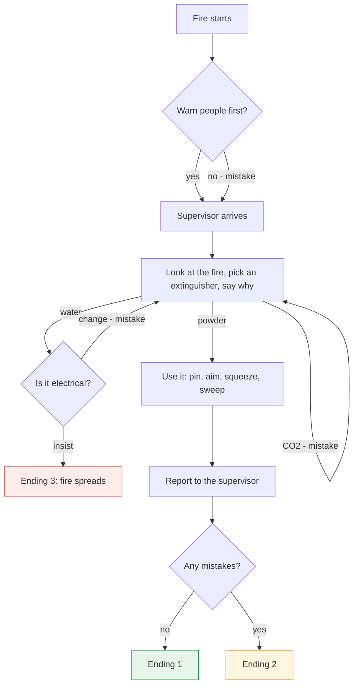
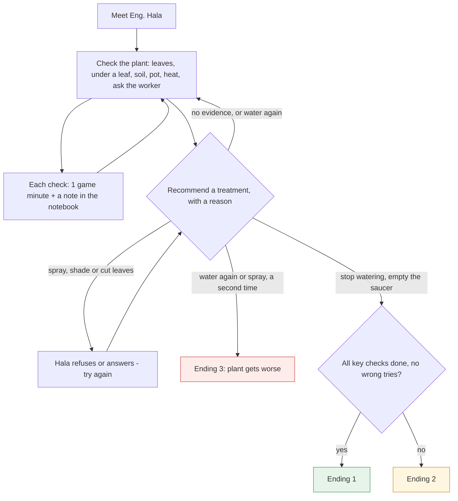
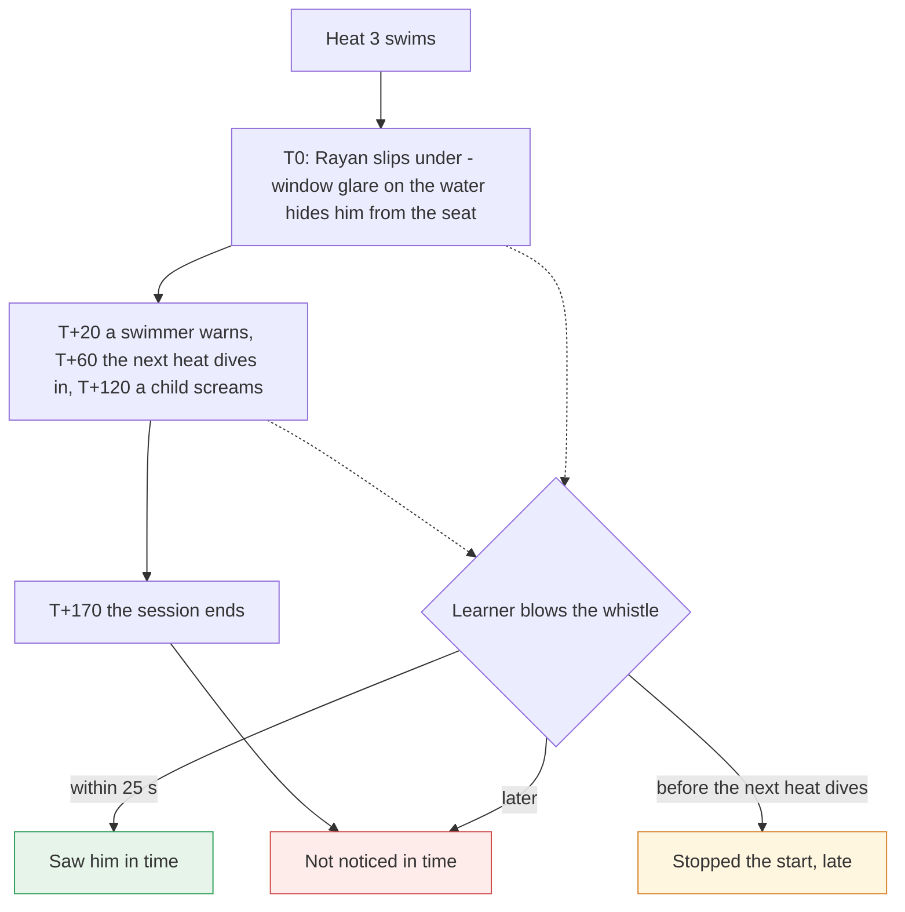
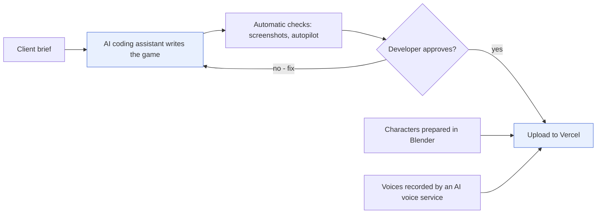

# Interactive Books Demos: Project Structure, Scenarios and Pipeline

This one file explains three things:

1. **Where everything is**: the project structure.
2. **How each scenario runs**: SAF-01, AGR-03, AQ-01.
3. **How a demo is made and delivered**: the pipeline.

Everything here was checked against the source code on 15 November 2026.

**Diagrams:**
- The diagrams here are simplified versions.
- All of them are also in [diagrams/interactive-books-diagrams.pdf](diagrams/interactive-books-diagrams.pdf), one per page.
- Full versions with every branch are in [diagrams/detailed/](diagrams/detailed/).

**Labels:**
- **Done**: works today.
- **Partial**: works, but simpler than the client brief.
- **Missing**: not built.
- **Proposed**: a future idea that does not exist yet.

---

## Part 1: Project structure

### 1.1 The folders

```
C:\book
├─ fp-extinguisher/                 ← the scenario demos (this folder is the web root)
│  ├─ saf01.html                    SAF-01 The Wrong Extinguisher      ~3,700 lines, one file
│  ├─ agr03.html                    AGR-03 The Wilting Tomato          ~2,600 lines, one file
│  ├─ aq01.html                     AQ-01 Still in Lane Four           ~870 lines
│  ├─ aq01/people.js, audio.js      AQ-01's two modules: generated people, generated sound
│  ├─ index.html                    Extinguisher Drill, the first prototype (SAF-01 was built from it)
│  ├─ grip/tripod.json              the calculated pen grip used by AGR-03
│  ├─ assets/
│  │  ├─ anim/                      motion-capture clips (Microsoft Rocketbox, MIT)
│  │  ├─ Construction_*/, Male_Adult_01/   Rocketbox characters (hidden animation rigs, first-person hands)
│  │  ├─ renderpeople/              photo-scanned people (the visible characters)
│  │  ├─ polyhaven/                 textures, furniture and sky (CC0)
│  │  ├─ audio/saf01/, audio/agr03/ recorded voice lines: mp3 + letter timings + manifest.json
│  │  └─ fullbody/, splat/, avatar/ PRIVATE research scans, never deployed
│  ├─ scenarios/saf01/              the old build script for SAF-01 (out of date, do not run)
│  ├─ tools/                        screenshot and frame-rate scripts, scan tools
│  └─ backups/                      38 dated HTML snapshots + 7 review images
├─ pumpjack/, pumpjack-drill/, pumpjack-field/   oil-pumpjack machine explorers (all built in code)
├─ deploy/saf01/, deploy/agr03/     the copies uploaded to Vercel
├─ docs/                            this documentation
└─ submission/ai-pipeline/scripts/  copies of the offline scripts (voices, Blender, grip solver, deploy)
```

Not in the project:
- **No `package.json`, no build step, no server, no git repository.**
- The games need no environment variables. `.env` is only read by the offline voice script.

Full file-by-file list: [PROJECT_STRUCTURE.md](PROJECT_STRUCTURE.md).

### 1.2 Inside one game file

Each game is a single page. Its code is split into numbered sections that share the same variables. Together they form five layers around a main loop:

| Layer | What it does | Main functions (SAF-01 / AGR-03) |
|---|---|---|
| Main loop | Loads the files in stages. Then, every frame, it updates everything and draws the picture. | `tick`, `loop` |
| 3D scene | Builds the world in code; loads characters and objects; draws fire, smoke and water | `loadWorkers`, `attachRP`, `updateFire` |
| Interaction | Keys and mouse; what you are looking at; your hands | `lookTargets`, `safUseE` / `useE`, `updateHands` / `updateHand` |
| Scenario manager | The story: lines, questions, decisions, mistakes, endings | `SAF` + `updateSAF` / `G` + `updateFlow`, `finish`, `judge` |
| UI | HTML on top of the 3D view: menu, objective, chat, answer buttons, review screen | `renderChoices`, `renderDlg`, `renderEnding` |
| Assets and data | Models, textures, voices, and the text tables inside the page | `assets/`, `TXT`, `ENDINGS` |

### 1.3 The most important files

| File | Role |
|---|---|
| `fp-extinguisher/saf01.html` | The whole SAF-01 game |
| `fp-extinguisher/agr03.html` | The whole AGR-03 game, including the notebook writing and the pot lift |
| `fp-extinguisher/aq01.html` | AQ-01 phase 1: the pool hall, water and glare, the race timeline, the whistle |
| `fp-extinguisher/aq01/people.js` | Swimmers and officials built in code (18-bone rig) and an instanced crowd |
| `fp-extinguisher/aq01/audio.js` | Hall sound synthesised in the browser, with no audio files |
| `fp-extinguisher/assets/audio/*/manifest.json` | The list of voice lines: who speaks, how long, which voice |
| `fp-extinguisher/grip/tripod.json` | Finger positions and pen pose for writing, loaded at every start of AGR-03 |
| `INTERACTIVE_3D_MACHINE_SPEC.md` | Instructions that let an AI agent build a new machine explorer |

---

## Part 2: The scenarios

### 2.1 How a scenario is written in code (all demos)

1. The client's texts are copied into a **table inside the page** (`TXT`), with Arabic and English for each line.
2. The story is a **to-do list of actions** (a queue) that the game works through every frame:
   - `say`: a character speaks a line. The voice plays, the lips move, and the text appears in the chat.
   - `ask`: show numbered answers and wait for a choice.
   - `card`: show an information card (AGR-03 only).
   - `wait` / `until`: pause for a time or until something happens.
   - `run`: run a piece of code.
3. What happens after each answer is written as a small JavaScript function (a callback). It adds the next items to the queue.
4. Good and poor decisions are recorded (`decide`) and mistakes are listed (`mistake`). The ending is chosen from these records.
5. AQ-01 is different: it uses a **clock**. Events happen at set times, and the whistle time decides the result.

Example from SAF-01 (simplified):
```js
SAF.now({ say: 'mahmoud', k: 'mah_electric' },                 // Mahmoud: "Wait, is it electrical?"
        { ask: true, who: 'mahmoud', opts: ['w_change', 'w_insist'],
          cb: w => w === 0 ? mistake('water_first')             // change to powder: a mistake is recorded
                           : takeExt('water', true) });         // insist: the water goes on the board -> ending 3
```

### 2.2 SAF-01: The Wrong Extinguisher (Done)

| | |
|---|---|
| Teaches | What to do in a small electrical fire: warn people first; read what is burning; **choose the right extinguisher and say why** (powder, never water, on a live power strip); use it with **PASS** (pull the pin, aim at the base, squeeze, sweep); report |
| Learner | A student in a farm shed at 11:00, in first person, using their own hands |
| Characters | Mahmoud (student), Mr. Fathy (worker), Eng. Karim (supervisor). Photo-scanned bodies with motion capture and lip-sync. |
| Live | https://instant-crystal-wnj8dit-islams-projects-5b27661f.vercel.app/ |

**Steps:**
1. Mr. Fathy shouts "grab the red one!". The learner chooses one of three:
   - send Mahmoud for Eng. Karim **and** get Mr. Fathy out (correct);
   - only get Mr. Fathy out (the alarm comes late);
   - grab an extinguisher first (Mahmoud asks "are you sure?").
2. Look at the power strip, the straw and the diesel (press E). Take an extinguisher and give a reason.
3. Use it: E to take, P or drag to pull the pin, right mouse for the hose, hold left mouse to squeeze, move the mouse to sweep.
4. Report to Karim: what burned, which extinguisher, and the likely cause.

**Endings:**
- **1:** no mistakes. Karim fixes the overloaded power strip.
- **2:** any mistake. The review lists them.
- **3:** you insisted on water. The flame jumps to the straw, everyone leaves, and you restart at step 2.

**Feedback:**
- The characters correct you.
- The fire shrinks where the powder lands (most at its base).
- Aim, sweep and standing with the draught at your back are scored.
- A review screen at the end.



**In the code:**
- Flow: `startFlow`, `step1`, `alarm`, `pickExt`, `afterReason`, `takeExt`, `SAF.onFireOut`, `finish`.
- Fire: `updateFire`.
- Hands: `tryTake`, `updateHands`.

### 2.3 AGR-03: The Wilting Tomato (Done)

| | |
|---|---|
| Teaches | **Look before you act.** Gather evidence, write it in a notebook, and choose the treatment that matches the real cause. The plant is not thirsty; its pot cannot drain. |
| Learner | A visiting student in a school greenhouse at 12:30 |
| Characters | Eng. Hala (supervisor) and Mr. Fathy (worker, kneading soil). Photo-scanned bodies, lip-sync, and gestures while talking. |
| Live | https://fast-dune-d4l8zrv-islams-projects-5b27661f.vercel.app/ |

**Steps:**
1. **Look and check, in any order** (press E): the leaves, the underside of a leaf (crouch first), the soil (your finger goes in at 3 cm, then deeper if you want), the pot (your hand lifts a leaf, then both hands lift the pot and water drips from the blocked hole), the heat, and asking Mr. Fathy.
   - Each check costs **1 game minute**.
   - Each check adds a note that you **watch being written** in a 3D notebook with five boxes: *what I see / what I checked / my guess / what I'm not sure about / what I recommend*.
2. **Talk to Eng. Hala:** give your guess, say what you are not sure about, then recommend A–E with a reason taken from the evidence you found.

**Endings:**
- **E1:** treatment B (stop the extra water, empty the saucer), and the key observations recorded: leaves, insects under a leaf, soil, pot, and asking Mr. Fathy (heat is optional). No earlier wrong recommendation.
- **E2:** treatment B, but something was missed or a wrong recommendation came first.
- **E3:** "water again" twice (or again after re-checking the soil), or spraying twice. Mr. Fathy waters the plant and it gets worse.

**Feedback:**
- Hala answers every recommendation by voice. She refuses spraying straight away.
- A recommendation with no evidence sends you back: "what did you see?".
- The review lists what you missed and suggests a level on a 4-skill teacher scale.



**In the code:**
- Checks: `useE`, `checkStart`, `checkSoil`.
- Notebook: `write`.
- Recommendation and endings: `talkHala`, `askAction`, `judge`, `endingFor`, `finish`.
- Hands: `handTouch`, `potLift`.
- Writing: `nbUpdate`, `loadGrip`.

### 2.4 AQ-01: Still in Lane Four (Partial: phase 1 of 4)

| | |
|---|---|
| Teaches | How to spot a **silent drowning**: a swimmer sinks without splashing while attention moves to the next race. |
| Learner | The lead lifeguard in the chair at a junior championship |
| Characters | Swimmers, officials, a second lifeguard and a crowd of 290, all built in code. Dialogue is text only (no voices yet). |
| Live | Not deployed |

**How it runs:** a clock drives the session.
1. Heat 3 swims.
2. Rayan touches the wall, drifts, rolls face down, and **slips under at T0**.
3. **The reflection of a bright window band on the water** hides the bottom of lanes 3–5 from the seat. Standing on the chair (Space) clears it.
4. Omar raises the alarm at T+20 and is sent away. Heat 4 dives in over Rayan at T+60. A heat-5 swimmer screams at T+120. The session ends on its own at T+170.

**Results by whistle time (F):**
- Within 25 s of T0: "You saw him and stopped everything".
- Before heat 4 dives: "You stopped the start, after a delay".
- Later, or never: "Not noticed in time".
- A whistle before T0 is counted as a false alarm, and play continues.

**Missing (phases 2–4):**
- The rescue in the water.
- Voices and decision questions.
- The brief's five endings, scoring and the review.



**In the code:**
- Timeline: `at` (session time), `atT` (time from T0).
- Whistle and result: `whistle`, `endPhase1`.
- Glare and gaze: `glareCover`, `updateGaze`.
- People and sound: `aq01/people.js` (`makeKid`, `makeAdult`, `makeCrowd`), `aq01/audio.js` (`createHallAudio`).

### 2.5 The scenarios side by side

| | SAF-01 | AGR-03 | AQ-01 |
|---|---|---|---|
| Story engine | Queue of actions | Queue of actions | Clock and timeline |
| Main skill | Choose and use the right tool | Gather evidence before acting | Notice what is hidden |
| Physical actions | Take, pin, hose, squeeze, sweep | Touch soil, lift pot, write notes | Stand, climb down, whistle |
| Voices | 43 lines | 40 lines | none yet |
| Endings | 3 | 3 + teacher scale | 3 results (phase 1) |
| Score saved | no | no | no |

---

## Part 3: The pipeline

### 3.1 How a demo was made (build pipeline)



| Step | Tool | Input → output | Script / file |
|---|---|---|---|
| 1. Read the brief and plan | Claude Code (AI coding assistant) | client PDF + developer's references → plan | — |
| 2. Write the game | Claude Code | plan → one HTML file per demo | `saf01.html`, `agr03.html`, `aq01.html` |
| 3. Prepare characters | Blender 5.2 (headless) | Renderpeople FBX → web GLB + baked shadows (AO) | `rp_to_web.py`, `bake_ao.py`, `mud_palms.py` |
| 4. Record voices | ElevenLabs `eleven_v3` | the game's text table → mp3 + letter timings + `manifest.json` | `gen_lines.py` |
| 5. Solve the pen grip | Own optimiser (CMA-ES, Node) | hand skeleton → `grip/tripod.json` | `grip-solver/*.mjs` |
| 6. Check | Headless Chrome, autopilot, review agents | game → screenshots, frame rate, every ending played | `shoot.ps1`, `perf.mjs`, `?auto=` |
| 7. Approve | The developer | screenshots → corrections or approval | — |
| 8. Publish | `sync_deploy.py` + Vercel CLI | game + only the assets it needs → live link | `deploy/<game>/` |

Copies of the scripts are in `submission/ai-pipeline/scripts/`. AI is used only in steps 1–2 (code) and 4 (voices). **Nothing calls AI while a learner plays.**

### 3.2 The voice pipeline in detail

1. `gen_lines.py` reads the game page. It finds every spoken line (`say` items) and its text (`TXT`), and maps each speaker to a voice.
2. For each line, ElevenLabs returns an **mp3 file** and the **start and end time of every letter**.
3. `manifest.json` lists each line: who speaks it, its duration, the voice and the model.
4. In the game, `speak` plays the mp3 from the speaker's head (3D sound). The letter timings drive the **jaw and lips** and reveal the words in the chat as they are spoken.

```bash
python -I gen_lines.py agr03.html assets/audio/agr03 hala=<voice_id>,eleven_v3 fathy=<voice_id>,eleven_v3 you=<voice_id>,eleven_v3
```

### 3.3 The character pipeline in detail

1. A **Rocketbox** character (MIT licence) plays real motion-capture clips. It is hidden.
2. A **Renderpeople** scanned person is converted to GLB in Blender and gets a baked shadow map. This is the visible character.
3. In the game, `attachRP` measures the difference between the two skeletons once. `updateRP` then copies the movement every frame.
4. The face (jaw, lips, eyes, blinks) is moved by code, in time with the voice.

### 3.4 What happens when a learner opens a demo (runtime pipeline)

1. The browser downloads the page and Three.js (from a CDN).
2. The world is built in code (walls, tables, pool).
3. Files load in stages: hands → objects → characters and motion → scanned bodies → voices. SAF-01 and AGR-03 download about 100 MB in total. AQ-01 and the pumpjack demos load no asset files.
4. The main loop starts. About 60 times a second it:
   - reads input;
   - moves the hands and the player;
   - updates the fire or water;
   - moves the story queue forward;
   - animates the characters;
   - draws the picture.

### 3.5 Future pipeline (Proposed, not built)

1. An AI writes the scenario as a **data file** (scenes, actions, ratings, endings).
2. Automatic checks verify it: every path reachable, safety rules respected.
3. The scene is assembled from **ready-made modules** (characters, hands, interactions, effects), and the voices are generated from the same file.
4. An autopilot plays every path and takes screenshots.
5. A person approves the result before it is published.

See [TECHNICAL_DOCUMENTATION.md](TECHNICAL_DOCUMENTATION.md) section 9 for the proposed platform architecture.
