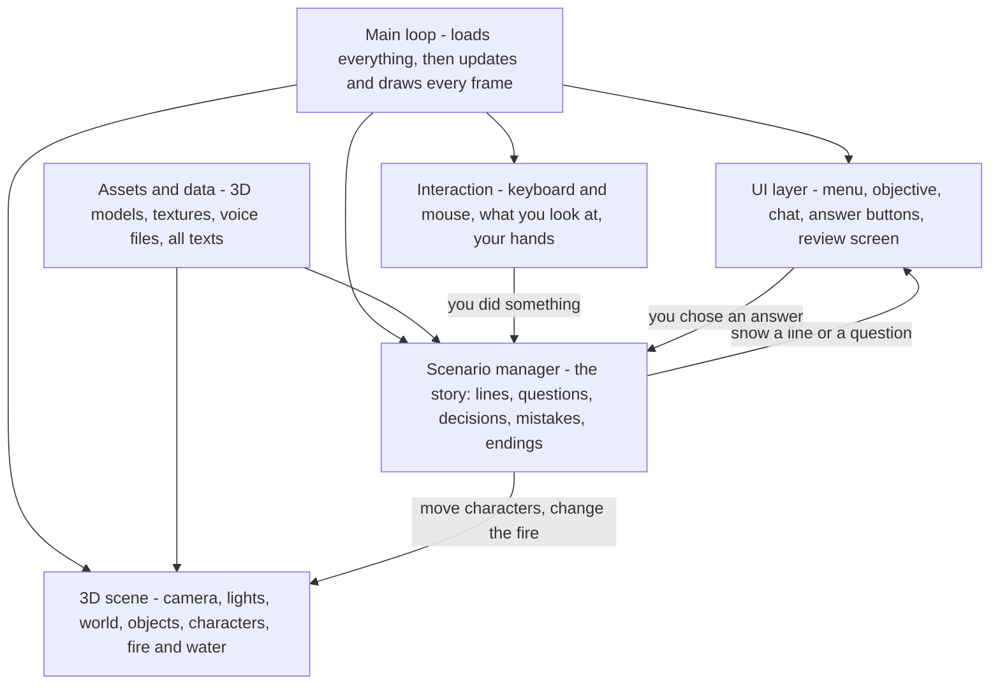
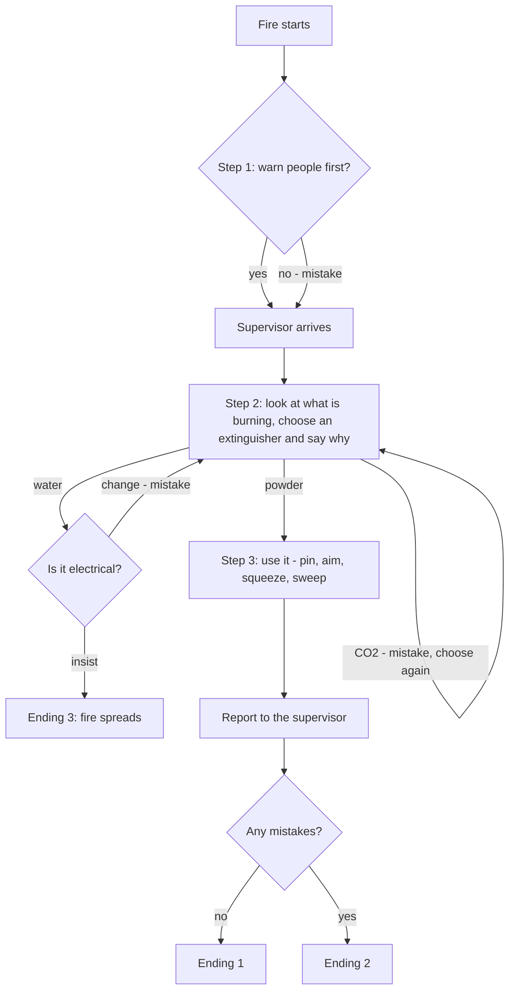
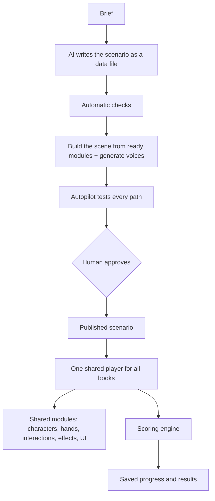

# Interactive Books 3D Demos: Technical Documentation

| | |
|---|---|
| Developer | Islam Sherif |
| Date | 15 November 2026 |
| Demos | SAF-01 *The Wrong Extinguisher* · AGR-03 *The Wilting Tomato* · AQ-01 *Still in Lane Four* (in progress) |
| Live links | SAF-01: https://instant-crystal-wnj8dit-islams-projects-5b27661f.vercel.app/ <br> AGR-03: https://fast-dune-d4l8zrv-islams-projects-5b27661f.vercel.app/ |
| More detail | [TECHNICAL_DOCUMENTATION_DETAILED.md](TECHNICAL_DOCUMENTATION_DETAILED.md): the same content with code line references |

**Labels used in this document**

| Label | Meaning |
|---|---|
| **Done** | Works in the demo today |
| **Partial** | Works, but simpler than the client brief |
| **Experimental** | In the code but switched off by default |
| **Missing** | Not built yet |
| **Proposed** | A recommendation for the future, not something that exists |

**Contents:** 1 Demo overview · 2 Technology stack · 3 System architecture · 4 3D world · 5 Scenario and interaction · 6 AI · 7 Challenges and limitations · 8 Recommendations · 9 Proposed architecture · Comparison table · 10 How each demo works · 11 Comparison of the demos · 12 Documentation verification

---

## Summary

- We built **3D training scenarios that run in the browser**. They are based on the client's situation briefs. The learner walks around in first person, looks at things, uses their hands, talks to characters, and makes decisions. The story reacts to those decisions.
- **Two demos are finished and online** (fire safety, agriculture). **One is in progress** (lifeguard).
- **Technology:**
  - Each demo is **one HTML file** using **Three.js**, a 3D library for the web. (AQ-01 also loads two small script files.)
  - There is no framework, no server and no database.
  - The files are hosted on **Vercel**.
- **Strengths:**
  - Very realistic people: photo-scanned bodies with real motion capture, and lips that move with recorded voices.
  - Hands that really do the task.
  - Physics-based effects where the lesson needs them (fire, water glare).
- **Weaknesses:**
  - The scenario is written as code, not as data.
  - There is no scoring or saving of results.
  - Code is copied from one demo to the next.
  - It works on desktop only.
- **Recommendation:** turn the good parts into **shared modules**. Then build **one player** that reads each scenario from a **data file**.

---

## 1. Demo Overview

### 1.1 The idea

Each demo is an Interactive Book page shown as a 3D world:

| Part of an Interactive Book | What we have |
|---|---|
| A character that moves | **The learner moves in first person** and sees their own hands. **Other characters** are photo-scanned people who walk, look at whoever is talking, and speak with moving lips. In AGR-03 they also gesture while talking. |
| A world | A farm shed (SAF-01), a school greenhouse (AGR-03), a 50 m swimming-pool hall (AQ-01) |
| Objects to interact with | Fire extinguishers, a burning power strip, straw, a diesel drum · a tomato plant, soil, a pot, a notebook and pen · a whistle |
| A learning scenario | Each demo follows a client brief: steps, questions, decisions with reasons, consequences, endings, and a final review |
| Animations | Motion capture for the body, calculated arm and finger movement, faces synced to the voice, fire and water effects |
| AI | **Used only while building the demos:** an AI coding assistant wrote the code, and an AI voice service recorded the dialogue. **No AI runs inside the demos.** |

### 1.2 SAF-01: The Wrong Extinguisher

| | |
|---|---|
| **What it teaches** | What to do in a small electrical fire: warn people first; look at what is burning; **pick the right extinguisher and explain why** (powder, never water, on a live power strip); use it correctly with **PASS** (Pull the pin, Aim at the base, Squeeze, Sweep); report what happened |
| **For** | First-year technical students |
| **Live demo** | https://instant-crystal-wnj8dit-islams-projects-5b27661f.vercel.app/ |
| **Repository** | https://github.com/islams1/interactive-books-3d-demos (private) |
| **Status** | **Done.** The whole scenario works, with 3 endings. |

- **Done:**
  - Walking around.
  - Inspecting objects (press E).
  - Taking an extinguisher.
  - Using it with the mouse (pin, hose, squeeze, sweep).
  - Fire that shrinks where the powder lands (aiming at the base works best). Aiming and sweeping are scored.
  - 3 characters who talk. 43 voiced Arabic lines in total: 20 for the characters, 22 for the learner's own answers, 1 narration.
  - A chat panel showing the conversation.
  - Numbered answers.
  - 3 endings and a review screen that lists your decisions and mistakes.
  - Arabic and English.
- **Missing or weak:**
  - No score and no saved results.
  - No time limit.
  - English has subtitles only, no voices.
  - Desktop only.

### 1.3 AGR-03: The Wilting Tomato

| | |
|---|---|
| **What it teaches** | **Look before you act.** Collect evidence, write it in a notebook, then choose the treatment that matches the real cause. (The plant is not thirsty: its pot cannot drain.) |
| **For** | Agriculture students aged 16–18 |
| **Live demo** | https://fast-dune-d4l8zrv-islams-projects-5b27661f.vercel.app/ |
| **Repository** | https://github.com/islams1/interactive-books-3d-demos (private) |
| **Status** | **Done.** The whole scenario works, with 3 endings and a teacher rating scale. |

- **Done:**
  - Checking the leaves, the underside of a leaf (you crouch), the soil (your finger goes into it), the pot (the hand lifts a leaf, then **both hands lift the pot** and water drips from the blocked hole), and the heat.
  - Asking the worker.
  - Each check costs 1 minute on the in-game clock.
  - **A 3D notebook that you write in while you watch.** The pen follows the letters.
  - Choosing a treatment from A to E and giving a reason. Spraying is refused straight away.
  - The supervisor answers each choice by voice.
  - 3 endings.
  - A review screen with discussion questions and a teacher scale. The game suggests a level for each of the 4 skills.
- **Missing or weak:**
  - No score and no saved results.
  - English has no voices.
  - Desktop only.

### 1.4 AQ-01: Still in Lane Four (in progress)

| | |
|---|---|
| **What it teaches** | How to spot a **silent drowning**. A 13-year-old swimmer sinks without splashing while everyone looks at the next race. **The reflection of a bright window on the water** hides him from the lifeguard's chair. |
| **For** | Lifeguards |
| **Live demo** | Not online yet |
| **Status** | **Partial:** phase 1 of 4 is built |

- **Done:**
  - A complete pool hall made in code, with no 3D files.
  - Realistic-looking water: waves, reflections, and an approximate view through the surface.
  - **Glare from real mirror geometry:** once the swimmer lies on the bottom, the window's reflection hides him from the seat but not when you stand on the chair.
  - Swimmers, officials and a crowd of 290.
  - Hall sounds generated in code.
  - The race timeline.
  - The whistle.
  - 3 result screens.
- **Missing:**
  - Rescuing the swimmer.
  - Voices and decision questions.
  - The full endings, scoring and review.

### 1.5 Earlier demos

| Demo | What it is |
|---|---|
| Extinguisher Drill | The first prototype. SAF-01 was built from it. |
| Oil pumpjack explorer | Explore a machine: rotate it, take it apart, cut it open, follow a guided tour |

---

## 2. Technology Stack

Only what we actually used:

| Part | What we used | Not used |
|---|---|---|
| Language | **JavaScript**, HTML, CSS. Python only for helper scripts. | TypeScript |
| Framework | **None.** Plain JavaScript. | React, Vue |
| 3D engine | **Three.js** version 0.170.0, loaded from a public CDN (an online file server) | Babylon.js, Unity |
| 3D integration | **None.** Three.js is used directly. | React Three Fiber |
| Animation | Three.js's built-in **AnimationMixer** plays motion-capture clips. Our own code moves the arms, fingers, eyes and lips. | GSAP |
| Physics | **None.** Our own simple code for collisions, falling objects and particles. | Rapier, Cannon.js |
| State management | **None.** Plain JavaScript objects. | Zustand, Redux |
| UI | Plain **HTML/CSS** on top of the 3D view | UI libraries |
| Sound | **Web Audio** (built into the browser). Voices come from the speaker's position in the room. | — |
| AI inside the demo | **None** | OpenAI, Gemini |
| AI while building | **Claude Code** wrote the code. **ElevenLabs** generated the voice recordings. | — |
| 3D content | Microsoft **Rocketbox** characters and motion (free, MIT licence), **Poly Haven** textures and models (free, CC0), **Renderpeople** scanned people (free samples, restricted licence), shapes made in code | AI-generated 3D models |
| Server / database | **None** | — |
| Deployment | **Vercel** (hosting for static files) | AWS |

**Why so little?** The goal was fast, realistic prototypes. A single file with no build step can be changed and tested in minutes. The price is that it does not scale well (see Sections 7 and 8).

---

## 3. System Architecture

### 3.1 The big picture

- Every demo is **one web page**. All its code is inside that HTML file, except AQ-01, which also loads two script files (`people.js`, `audio.js`).
- When a learner opens the link, the browser downloads the page, the Three.js library and the asset files (3D models, textures, recorded voices).
- **Everything runs inside the browser.** There is no server code and no database.

### 3.2 The parts inside the page

The code is split into numbered sections that share the same variables. They form five layers around a **main loop**, which runs about 60 times per second, updating everything and drawing a new picture each time.



| Layer | What it does | Main code (function names) |
|---|---|---|
| Main loop | Loads the files in order. Then, every frame, updates all parts and draws the picture. | `tick`, `loop` |
| UI layer | Everything drawn in HTML over the 3D view | `renderChoices`, `renderDlg`, `renderEnding` |
| 3D scene | Builds the world in code; loads characters and objects; draws fire, smoke and water | `loadWorkers`, `attachRP`, `updateFire` |
| Interaction | Reads keys and mouse; finds what you are looking at; moves your hands | `lookTargets`, `useE`, `updateHands` |
| Scenario manager | Runs the story step by step; checks answers; records mistakes; picks the ending | `SAF` / `G` objects, `updateSAF`, `judge`, `finish` |
| Assets and data | 3D files, pictures, voice files, and the text tables inside the page | `assets/` folder, `TXT` table |

### 3.3 Folder structure

```
fp-extinguisher/        ← the scenario demos
   saf01.html           SAF-01 (one file, ~3,700 lines)
   agr03.html           AGR-03 (~2,600 lines)
   aq01.html + aq01/    AQ-01 (+ people.js, audio.js)
   assets/              characters, animations, textures, voice recordings
   grip/tripod.json     the calculated pen grip for AGR-03
pumpjack*/              the machine explorer demos
deploy/                 the copies uploaded to Vercel
```

Full list: [PROJECT_STRUCTURE.md](PROJECT_STRUCTURE.md).

### 3.4 How the 3D scene is drawn

1. The page loads Three.js.
2. It creates the **renderer** (the part that draws), the camera and the lights.
3. It **builds the world in code**: walls, tables, the pool.
4. It **loads the files in stages**: hands, then objects, then characters and animations, then voices. Files inside a stage load together. Nothing is shown until every stage is done.
5. It starts the **main loop**. Each frame it:
   - moves the player and the hands;
   - updates the fire or water;
   - moves the story forward;
   - animates the characters;
   - draws the picture.

### 3.5 How the state changes

"State" means the current situation of the game: which step you are on, what you chose, what mistakes you made. It is kept in **plain JavaScript objects** (`SAF` in SAF-01, `G` in AGR-03). Any part of the code can read or change them.

**Example: the learner picks the water extinguisher in SAF-01**
1. The learner presses **E** while looking at the water extinguisher.
2. The game asks "why this one?" and shows numbered answers.
3. The learner presses **1**. The answer is saved, and the choice is recorded as a poor decision.
4. Mahmoud says "Wait, is it electrical?" The voice plays, his lips move, and the line appears in the chat.
5. If the learner **changes** to powder, a mistake is recorded and the game continues. If the learner **insists**, the water hits the power strip, the fire jumps to the straw, and the game shows ending 3.
6. At the end, the game reads the recorded mistakes to pick ending 1 or 2.

### 3.6 How the parts talk to each other

There is no framework, so the parts talk in simple ways:

| Way | Example |
|---|---|
| **One part calls another** | Pressing E on the soil calls the "check soil" function |
| **Shared objects** | The fire reads which extinguisher the learner chose |
| **The story queue**: a to-do list of actions (say a line, ask a question, wait, run something) that the scenario manager works through in order | After an answer, the next lines are added to the queue |
| **Events** | Actions are reported as events: the hands report "pin pulled", and the fire reports "spray started", "fire out" and "extinguisher empty". Events are logged. Only "fire out" and "extinguisher empty" move the story on. |

---

## 4. 3D World Construction

### 4.1 Worlds and objects

| Demo | World | How it was made |
|---|---|---|
| SAF-01 | Farm shed with an office | Walls and structure **built in code**. Real-world textures and furniture from **Poly Haven**. The story objects (power strip, straw, sacks) built in code. |
| AGR-03 | School greenhouse | Built in code with Poly Haven textures and props. **The tomato plant is generated in code**, and its leaves droop as the story changes. |
| AQ-01 | Competition pool hall | **100 % built in code.** No 3D files at all. |

No 3D model was generated by AI.

### 4.2 Characters

1. A Microsoft **Rocketbox** character (hidden) plays a **motion-capture** animation: real recorded human movement.
2. A **Renderpeople** photo-scanned person (visible) copies that movement every frame.
3. Our code moves the **jaw, lips and eyes** in time with the recorded voice, using the timing of each spoken letter.
4. The learner's **own hands** come from a Rocketbox character. Code calculates the arm and finger angles so the hand reaches the right spot: the pin, the soil, the pot, the pen.

### 4.3 Assets

| Assets | Format | Source | Licence |
|---|---|---|---|
| Characters and motion | FBX | Microsoft Rocketbox | Free (MIT) |
| Textures, furniture, sky | JPG, glTF, HDR | Poly Haven | Free (CC0) |
| Scanned people | GLB | Renderpeople free samples | **Restricted:** training use needs written permission (Renderpeople terms as noted by the developer; not verified from files) |
| Voices | MP3 + timing file | ElevenLabs (made before, not live) | Free plan: **commercial use not covered** (developer's notes) |

### 4.4 Camera, movement, physics

- **Camera:** first person at eye height. You can crouch. In AGR-03 the camera moves down smoothly when you write in the notebook.
- **Movement:** WASD keys plus the mouse. Characters follow set paths and stop or walk around you.
- **Physics:** no physics engine. Our own code handles walls, a dropped pin or extinguisher falling, and fire particles.

### 4.5 Performance

- **What we did:**
  - Two graphics levels (low / high).
  - Many copies of the same object drawn together (loose straw; the crowd uses two such batches).
  - The hands are drawn separately so they never go through walls.
  - The notebook text is updated line by line instead of redrawing the whole page.
- **Reported, not re-measured:** about 47 frames per second for SAF-01 on an Intel HD 630 built-in graphics chip. This comes from the developer's notes; no measurement is saved in the project.
- **Missing:**
  - Compressed 3D files.
  - Faster loading: each stage waits for the previous one.
  - A loading progress bar. SAF-01 and AGR-03 download about 100 MB before they start. AQ-01 and the pumpjack demos load no asset files.

---

## 5. Scenario & Interaction System

### 5.1 From a brief to a game

1. Read the client brief.
2. Copy its texts into a table in the page (Arabic and English).
3. Turn each **step** into part of the story queue.
4. Turn each **check** into a real action in the world: look, touch, lift, spray.
5. Turn each **decision** into a numbered question. What happens after each answer is written in code.
6. Turn the **ending rules** into a small function that looks at the decisions and mistakes.

### 5.2 How decisions lead to endings

| Demo | Ending 1 (best) | Ending 2 | Ending 3 (bad) |
|---|---|---|---|
| SAF-01 | No mistakes | Any mistake | Insisted on using water on the power strip |
| AGR-03 | Right treatment (B) + the 5 key observations (leaves, insects under a leaf, soil, pot, asking the worker; heat is optional) + no earlier wrong recommendation | Right treatment, but an observation is missing or a wrong recommendation came first | "Water again" twice (or again after re-checking the soil), or spraying twice |
| AQ-01 | Whistle within 25 s | Whistle before the next heat dives in | Later, or no whistle (the session ends on its own) |

The SAF-01 flow (simplified; the full flow with every mistake is in the detailed version):



### 5.3 Feedback and assessment

- **Feedback comes from the world:** characters answer and correct you, and the fire reacts to your technique.
- **At the end:** a review screen lists each decision (good or poor), your mistakes and the lesson. AGR-03 also shows a teacher scale and suggests a level for each skill.
- **Missing:** a numeric score, competency tracking, and saving or sending results.

### 5.4 Reusable vs hard-coded

| Already general (can be reused) | Written only for this demo |
|---|---|
| Characters with motion and lip-sync · voices · hands · notebook · chat and answer buttons · the story queue | All texts · what happens after each answer · positions of every object · numbers like "how well you must aim" · ending rules |

---

## 6. AI Integration

**No AI runs inside the demos.** We checked the code: it calls no AI service.

AI was used **only while building**:

| Tool | Used for |
|---|---|
| Claude Code (AI coding assistant) | Read the client briefs and wrote all the code. The main model was Claude Opus 5.5; some helper agents used Sonnet 5.5 or Haiku 5.5. |
| ElevenLabs (AI voices) | Recorded the 83 dialogue lines, with the timing of each letter for lip-sync |

**One exception, switched off and never deployed:** an experimental option in SAF-01 (`?karim=scan`) uses research body scans. An AI tool (LHM) rebuilt those bodies from AI-generated images, and their licence is research-only.

**Role of the human:**
- Checked every visual step with screenshots.
- Chose the characters and the voices.
- Created the accounts and keys.
- Approved the content.

**What took the most human effort:** realistic hands (the pen grip) and the camera feel.

**Future idea (Proposed, not built):**
1. An AI writes the scenario as a **data file**.
2. Automatic checks verify it.
3. The system builds the scene from **ready-made modules**.
4. An autopilot plays every path.
5. A person approves it.

More: [AI_INTEGRATION.md](AI_INTEGRATION.md).

---

## 7. Challenges & Limitations

### 7.1 Hard problems we solved

| Problem | How we solved it |
|---|---|
| Scanned people and the motion files use different skeletons | Copy the movement bone by bone every frame, after measuring the difference once |
| Lips had to match Arabic speech | Use the time of each spoken letter from the voice service to move the jaw and lips |
| A realistic hand holding a pen | A separate program searched for the best finger positions, then the game loads the result |
| The hand went *into* the pot | Measured each finger against the pot wall until all fingers stayed outside |
| Writing in the notebook slowed the game | Update only the line being written, not the whole page |
| The drowning swimmer had to be hidden for a *real* reason | Calculate the sunlight reflection on the water like real optics |

### 7.2 Current limitations

| # | Limitation | Why it matters | Suggested fix |
|---|---|---|---|
| 1 | The story is written as code | Hard to change, check or generate | Store scenarios as data files |
| 2 | No real scoring or saving | Teachers get no results | A scoring engine + saving results |
| 3 | Code is copied between demos | Every fix has to be done several times | Shared modules |
| 4 | No git, no automatic tests | No history, nothing catches regressions | Git + automatic test runs |
| 5 | ~100 MB (SAF-01, AGR-03) loaded before the start, no progress bar | Slow first load | Compressed files, parallel loading, progress bar |
| 6 | Desktop only | No phones or tablets | Touch controls |
| 7 | English has no voices | Unequal experience | Generate English voices |
| 8 | Test shortcuts are left in the live version | Learners could skip steps | Hide them in the live build |
| 9 | Licences: scanned people and the free voice plan | Could block selling the product | Get permission or replace; paid voice plan |
| 10 | AQ-01 is not finished | Rescue, endings and review are missing | Build them on the shared modules |

Full list with evidence: [TECHNICAL_LIMITATIONS.md](TECHNICAL_LIMITATIONS.md).

---

## 8. Recommendations

**Keep:**
- The realistic characters with lip-sync.
- The voice pipeline.
- The hands.
- The interaction pieces: the extinguisher, the notebook, lifting objects.
- The fire and water effects.
- The autopilot used for testing.

**Change:**
- Scenarios become data files, not code.
- Add a real scoring engine.
- Build one shared player instead of copied files.
- Hide the test shortcuts in the live build.
- Add touch support.

**Make faster:**
- Compressed 3D files.
- Parallel loading with a progress bar.

**Reusable components:**

| Component | Ready to reuse today? |
|---|---|
| Character animation + lip-sync | **Yes.** The same code already runs in two demos. |
| Voice system | **Yes**, same format in both demos |
| Chat and answer buttons | **Yes** |
| First-person hands | **Yes** |
| People and sound generated in code (AQ-01) | **Yes**, already separate files |
| Story queue | **Partly.** The idea is general, but parts are tied to each demo. |
| Scene manager, asset loader, interaction manager, state manager, scoring, progress tracking, AI scenario generator | **No (Proposed).** They need to be built. |

---

## 9. Proposed Architecture (future, not built)



| | Today | Proposed |
|---|---|---|
| Code | A copied file per demo | One shared player |
| Scenario | Written in code | A data file |
| Scoring | None | A real engine |
| Results | Lost on reload | Saved and reported |
| Loading | Slow, no progress bar | Compressed, with progress |
| New book | A new code file per scenario (days of work) | Mostly writing a data file |

---

## Comparison table

| Area | Today | Problem | Recommended |
|---|---|---|---|
| 3D rendering | Three.js, one setup per demo | Repeated in each file | One shared renderer |
| Scene management | World built in code when the page loads | No switching between scenes | Scene manager |
| Assets | Plain files, loaded in stages | Slow start, licences not tracked | Compressed files + licence list |
| Character control | Own first-person code per demo | Desktop only, copied | Shared controller with touch |
| Animation | Motion capture copied to scanned bodies + own code | Done twice per character | Prepare animations in advance |
| Physics | None, own simple code | Simple shapes only | Add a physics library only where needed |
| Interaction | Look + E, hand actions, per demo | Not reusable | Shared interaction manager |
| Scenario | Story queue written in code | Not data-driven | Scenario data files |
| State | Plain JavaScript objects | Can't save or resume | State manager with save |
| AI | Only while building | Each scenario is new code | AI writes data; code decides |
| Assessment | List of decisions and mistakes | No score | Scoring engine |
| Progress tracking | None | Results lost | Save and report results |
| Deployment | Manual upload to Vercel | Easy to make mistakes | Automatic build and release |
| Performance | Quality levels, a few optimisations | Not measured on weak devices | Speed checks in testing |

---

## 10. How each demo works

Every claim in this section comes from the source files. The main functions are named so a reader can search for them. Line numbers are in [TECHNICAL_DOCUMENTATION_DETAILED.md](TECHNICAL_DOCUMENTATION_DETAILED.md).

### 10.1 SAF-01: `fp-extinguisher/saf01.html`

| Aspect | How it works |
|---|---|
| Structure | One file, about 3,700 lines, in numbered sections: text → renderer and scenes → shed → extinguisher → hands → characters (NPCs) → particles → state → Engine → input → hand state machine → player → fire → emotion → physics → HUD → menu → demo → the SAF-01 situation module → main loop |
| Start-up | Builds the shed in code; its props and textures start loading at once. Then loads in stages: fonts, the first-person hands, Rocketbox characters and clips, Renderpeople bodies (`attachRP`), voices (`loadVoices`), and the extinguisher rack. Files inside a stage load in parallel. The loop starts after all stages finish. |
| Every frame (`tick`) | Updates: demo, player, pin, hands, fire, emotion, physics, hose, PASS aim, scenario (`updateSAF`), characters, scanned bodies and faces, HUD (every 3rd frame). Then draws the world, clears depth, draws the hands scene, then the vignette/grain pass. |
| Input and events | `keydown` listener: **E** (`safUseE` → inspect or `pickExt`), **P** (pin), **G** (drop), **1–4** (`SAF.pick`), Space (jump), C (crouch), Shift (run); right mouse toggles the hose, left mouse squeezes. Physical actions are reported with `Engine.dispatch` (19 event types, from the hands, the fire and the stress model). `fire_out` and `extinguisher_empty` trigger `SAF.onFireOut` / `SAF.onEmpty`. |
| Interaction | `lookTargets` finds the object in view and in reach (the `LOOKS` table). The hand state machine (`tryTake`, `updateHands`) runs take → pin → hose → squeeze → sweep. Agent particles inside the fire volume lower its health, most below 0.8 m (`updateFire`). Aim and sweep are scored separately. Stress makes the hands hesitate and the pin slip. |
| Scenario execution | The `SAF` queue (`SAF.add` / `SAF.now`, run by `updateSAF`) works through `say` / `ask` / `wait` / `until` / `run` items. Answers call callbacks (`step1`, `afterReason`). `decide` and `mistake` record the outcome, and `finish` picks the ending. |
| Animation and assets | Rocketbox clips on a hidden rig → copied every frame to Renderpeople bodies (`updateRP`). Faces: `setupFace` / `updateFace`, driven by letter timings from the voice files. |
| Performance | Low/high quality tier; a separate hands pass; instanced straw; HUD every 3rd frame; plain glass instead of costly "transmission" glass |

### 10.2 AGR-03: `fp-extinguisher/agr03.html`

| Aspect | How it works |
|---|---|
| Structure | One file, about 2,600 lines: text → renderer → helpers → greenhouse → tomato → people → state/input/player → hands, notebook, grip, writing → the situation → HUD/menu/loop |
| Start-up | Builds the greenhouse and the tomato in code. Then loads in stages: fonts, Poly Haven props, characters, Renderpeople bodies, hands + `grip/tripod.json` (`loadGrip`, used at every start), and voices. |
| Every frame (`tick`) | Updates: player, hands and notebook (`updateHand`, `nbUpdate`), scenario (`updateFlow`), characters, scanned bodies, faces, kneading, plant state (`plantState`). Then draws the world and the post pass. |
| Input and events | `keydown`: **E** (`useE`), **1–9** (answers), **N** (shrinks or restores the notebook panel on screen). `Engine.dispatch` logs `check`, `recommend` and `ending`. |
| Interaction | `lookTargets` + `useE` → `checkLeaves` / `checkUnder` / `checkSoil` / `checkPot` / `checkHeat` / `askFathy`. Each check calls `checkStart`, which adds 1 game minute. The hands use IK (`solveArm`), with `handTouch` for the soil and `potLift` for the pot. |
| Scenario execution | The `G.q` queue (`add` / `now`, run by `updateFlow`). Notebook entries go through `write` into `G.book`, and evidence into `G.ev`. The recommendation goes through `askAction` → `judge`. Endings are chosen by `endingFor` and `finish`. |
| Notebook writing | A canvas page on a 3D pad. Each line being written is a small strip revealed up to the pen tip (`nbStripMake`, `nbInk`). The hand is placed from the pen position (`handFromPen`). |
| Performance | Line-by-line strips instead of re-uploading the whole page texture; quality tiers |

### 10.3 AQ-01: `fp-extinguisher/aq01.html` + `aq01/people.js` + `aq01/audio.js`

| Aspect | How it works |
|---|---|
| Structure | The main file (about 870 lines) plus **two separate ES modules**. This is the only demo split into files. |
| Start-up | Builds the hall, the pool and the materials in code. Loads `people.js` and `audio.js` with `import()`; if they fail, it uses stand-ins or runs silent. Captures a reflection cube of the hall once. |
| Every frame (`tick`) | Advances the session clock `S.t` and fires the timeline events (`at`). Updates heats, ripples, player, gaze and crowd. Draws a **refraction pass** of the pool into a render target, then the main pass with the water shader. |
| Input and events | Mouse look; **Space** switches between sitting and standing on the chair; **E** climbs down to the deck (or back to the seat when near it); WASD on the deck; **F** = `whistle`. |
| Interaction | Gaze is logged when the view stays on the casualty (`updateGaze`). `glareCover` computes how much of him the window's reflection hides from the current eye position; it feeds only the log and the end card. A whistle before T0 counts as a false alarm. |
| Scenario execution | A **time-based timeline**, not a queue. `at` schedules events by session time and `atT` relative to T0, the moment the swimmer starts sinking. The whistle stops later events. `endPhase1` shows one of 3 results: within 25 s, before heat 4 dives in, or later. The session ends on its own at T+170. |
| Animation and assets | No asset files. `people.js` builds skinned swimmers and officials with a procedural 18-bone rig and pose states (stroke, dive, drift, sink), plus an instanced crowd. `audio.js` synthesises the hall sound with plain Web Audio. |

### 10.4 Machine explorers: `pumpjack/`, `pumpjack-drill/`, `pumpjack-field/`

| Aspect | How it works |
|---|---|
| Structure | One file per version. Parts are `Part` objects built from code primitives (no asset files). |
| Motion | A single crank angle drives every moving part through an analytic linkage solver (`solve`) |
| Interaction | `OrbitControls`; hover and click a part (`pick`); camera views (`flyTo`); exploded / cutaway / X-ray modes; labels with leader lines |
| Scenario | A **guided tour** (`TOUR` steps with timed actions) on a seekable timeline. The drilling version adds a phase table so the well can be rebuilt for any moment of the timeline. |
| Other | Live HUD charts (`drawSpark`, `drawDyno`), English/Arabic (`I18N`), deep links (`applyHash`) |

---

## 11. Comparison of the demos

### 11.1 Shared technology

| | SAF-01 | AGR-03 | AQ-01 | Pumpjack | Drill |
|---|---|---|---|---|---|
| three.js 0.170.0 via CDN import map | yes | yes | yes | yes | yes |
| Addons | GLTF, FBX, RGBE loaders; RoomEnvironment; RoundedBox; SkeletonUtils | same minus SkeletonUtils | none in the page (`people.js` uses BufferGeometryUtils) | OrbitControls; RoomEnvironment; RoundedBox | GLTF, FBX loaders; RoomEnvironment; RoundedBox; SkeletonUtils |
| Asset files | Rocketbox, Poly Haven, Renderpeople, voices | same + `tripod.json` | **none** | **none** | Rocketbox, scans, Sketchfab hand |
| Separate JS modules | no | no | **yes** (2) | no | no |
| Story model | action queue | action queue | timeline | guided tour | hand/fire state only |

### 11.2 How much code is repeated (measured)

Two measures were used:
- **Lines:** lines longer than 12 characters that appear unchanged in both files.
- **Functions:** functions with the same name; "nearly identical" means the bodies are at least 95 % similar.

| Pair | Repeated lines | Same-name functions | Nearly identical |
|---|---|---|---|
| Drill → SAF-01 | 78 % of the Drill's lines are in SAF-01 (1,980 lines) | 84 | 75 |
| SAF-01 ↔ AGR-03 | 523 lines (17 % of SAF-01, 24 % of AGR-03) | 63 | 27 |
| SAF-01 / AGR-03 ↔ AQ-01 | 38 lines (~1–2 %) | 5 (`applyLang`, `loop`, `mk`, `tick`, `updatePlayer`) with different code | 0 |
| Pumpjack → drill → field | 97–99 % of lines | 49–55 | 46–55 |

**What this means:**
- SAF-01 is mostly the Drill engine plus a scenario.
- AGR-03 copied the character, voice, face and chat systems from SAF-01 and wrote new world, hands-use and notebook code.
- AQ-01 was written from scratch.
- The three pumpjack pages are near-copies of each other.

### 11.3 Reused today vs could be reused

**Important:** no component is shared as a common file between demos today. Every "reuse" so far is a **copy** of code.

| Component | Status today | Evidence |
|---|---|---|
| Voice playback + lip-sync (`loadVoices`, `speak`, `setupFace`, `updateFace`, `alignTarget`) | **Reused by copying** (SAF-01 ↔ AGR-03) | nearly identical in both |
| Chat transcript + answer buttons (`showSub`, `renderDlg`, `dlgTick`, `renderChoices`, `chatPick`) | **Reused by copying** | nearly identical in both |
| Texture and material helpers (`pbr`, `canvasTex`, `mk`, …) | **Reused by copying** | nearly identical in both |
| Renderpeople retargeting (`attachRP`, `updateRP`), NPC clips, `npcLook` | **Reused by copying, then changed** | same names, different bodies |
| First-person hands + IK | **Reused by copying, then extended** (AGR-03 adds touch, pot, pen) | same names, different bodies |
| Scenario queue | **Same idea, re-written** (`SAF.q` / `updateSAF` vs `G.q` / `updateFlow`) | different code |
| Procedural people + synthesised audio (`aq01/*.js`) | **Could be reused**. They are modules, but used only by AQ-01 today. | separate files with exports |
| Water + glare optics, fire + agent particles, notebook writing, PASS kit | **Could be reused** after extraction | single-demo code |
| Scene manager, asset loader, interaction manager, state manager, scoring, progress tracking | **Do not exist** (Proposed) | — |

### 11.4 Demo-specific logic

| Demo | Logic that only makes sense for this demo |
|---|---|
| SAF-01 | Fire classes vs extinguisher types, PASS checks (aim, sweep, draught), the report questions, the flame jumping to the straw |
| AGR-03 | The 5 checks, the notebook boxes, evidence → reasons (`EV_REASON`), the A–E rules in `judge`, the plant reacting to the story |
| AQ-01 | The race timeline, the casualty's drift and sink, the glare geometry, whistle timing thresholds |
| Pumpjack | The linkage solver, the drilling phases |

### 11.5 Architectural differences

| Question | SAF-01 | AGR-03 | AQ-01 | Pumpjack |
|---|---|---|---|---|
| How the story moves | Queue of actions + callbacks | Queue of actions + callbacks | Clock-based timeline | Tour steps on a timeline |
| Where content lives | JS tables in the page | JS tables in the page | JS tables in the page | JS tables in the page |
| Characters | Scanned bodies + mocap | Scanned bodies + mocap | Procedural rig | none |
| World | Code + library assets | Code + library assets | Code only | Code only |
| Render passes | world → hands → post | world → post | refraction → main | single pass + labels |
| Voices | 43 recorded lines | 40 recorded lines | none (text only) | none |
| Code split | one file | one file | page + 2 modules | one file |

### 11.6 Limitations and missing capabilities, side by side

| Capability | SAF-01 | AGR-03 | AQ-01 | Pumpjack |
|---|---|---|---|---|
| Full scenario with endings | yes | yes | partial | n/a (tour) |
| Numeric score / grade | no | no | no | n/a |
| Saved results / LMS | no | no | no | no |
| Voices | Arabic only | Arabic only | none | none |
| Mobile / touch | no | no | no | orbit works with touch (not verified) |
| Loading progress | no | no | n/a (no assets) | n/a |
| Automated tests | no (autopilot only) | no (autopilot only) | no (`?auto`, `?freeze`) | no |
| Live link | yes | yes | no | expired |

---

## 12. Documentation verification

### 12.1 How the claims were checked

- **Independent review.** Three reviewers compared the documents with the source code. They were separate AI agents that took no part in writing the documents.
  - Reviewer 1: SAF-01 and the Extinguisher Drill.
  - Reviewer 2: AGR-03 and the AI and voice pipeline.
  - Reviewer 3: AQ-01, the pumpjack demos and the project structure.
  - Together they checked about **370 claims**. About **320 were correct as written**, and every other one was corrected or clarified.
- **Code references.** An automatic check confirmed that 266 of the 270 `file:line` references in the detailed version point at the named function or variable. The other 4 were ranges and are now single lines.
- **Diagrams.** All Mermaid diagrams were checked with Mermaid's own parser.
- **Local commands.** The local server commands were run, and every page answered HTTP 200.

### 12.2 Main corrections

| Topic | Earlier text said | Corrected to (verified in code) |
|---|---|---|
| AGR-03 pen grip | "experimental" | Loaded at every start (`loadGrip`). The simpler grip is only a fallback if the file is missing. |
| AGR-03 teacher scale | Shown for the teacher to fill in | The game suggests a level for each skill (`rubric`) |
| AGR-03 best ending | "all 5 checks" | The 5 key observations are leaves, insects under a leaf, soil, pot and asking the worker. The heat check is optional. Ending 3 also happens on a repeated "water again" after re-checking the soil. |
| SAF-01 fire | "reacts to aim and sweep" | Shrinks where the powder lands. Aim and sweep are scored separately. |
| SAF-01 voices | "3 characters, 43 lines" | 20 character lines, 22 learner lines, 1 narration |
| SAF-01 events | Only "fire out" moves the story | "fire out" and "extinguisher empty" both do. There are 19 event types, also sent by the fire and the stress model. |
| SAF-01 characters | "use gestures" | Talking gestures exist only in AGR-03 |
| Loading | "one after another" | In stages; the files inside a stage load in parallel |
| AQ-01 glare | "sunlight; clears when you stand or move" | It is the reflection of a daylit window band. Standing on the chair clears it; on the deck it depends on where you stand. |
| AQ-01 results | "25 s and 170 s thresholds" | Within 25 s / before heat 4 dives in / later. The session ends on its own at T+170. |
| AQ-01 files | "one HTML file" | One page plus 2 modules |
| AQ-01 crowd | "skinned" | Instanced, not skinned |
| URL switches | AGR-03: 60, AQ-01: 8 | AGR-03: about 70, AQ-01: 6 |
| Backups | 45 HTML snapshots | 38 HTML + 7 PNG |
| Repeated code | "~1,000 lines, 25 near-identical" | 523 substantive lines; 27 nearly identical functions |
| AI-generated content | "no generative model referenced anywhere" | None in the shipped demos. An experimental option, switched off and never deployed, uses research bodies that an AI tool (LHM) rebuilt from AI-generated images. |
| AI models | Claude Opus only | Opus was the main model; some helper agents used Sonnet or Haiku |
| Performance | "measured 47 fps" | Reported in the developer's notes, not re-measured |

### 12.3 Needs confirmation from the developer

These items cannot be verified from the files in the project:
- **The client briefs (PDFs).** They are not in the project folder. The brief-based statements depend on them: target audiences, the SAF-01 "one mistake" rule for ending 2, the 10-minute limit, and AQ-01's 4-phase plan and script changes.
- **Licence terms:** Renderpeople (use in training) and the ElevenLabs plan (commercial use).
- **The ~47 fps figure:** no saved measurement exists.
- **Effort hours:** these come from the developer's notes.
- **Live links and the deploy command:** the links answered HTTP 200 from this machine on 2026-11-15; the deploy command comes from the developer's notes.
- **AQ-01 sound in demo mode:** with `?play` or `?auto`, the audio is created without a click, so the demo may start silent in Chrome. This was not tested.

### 12.4 Source code not modified

Only documentation files were created or edited, in `docs/` and `submission/`. No game, script, asset or configuration file was changed.
