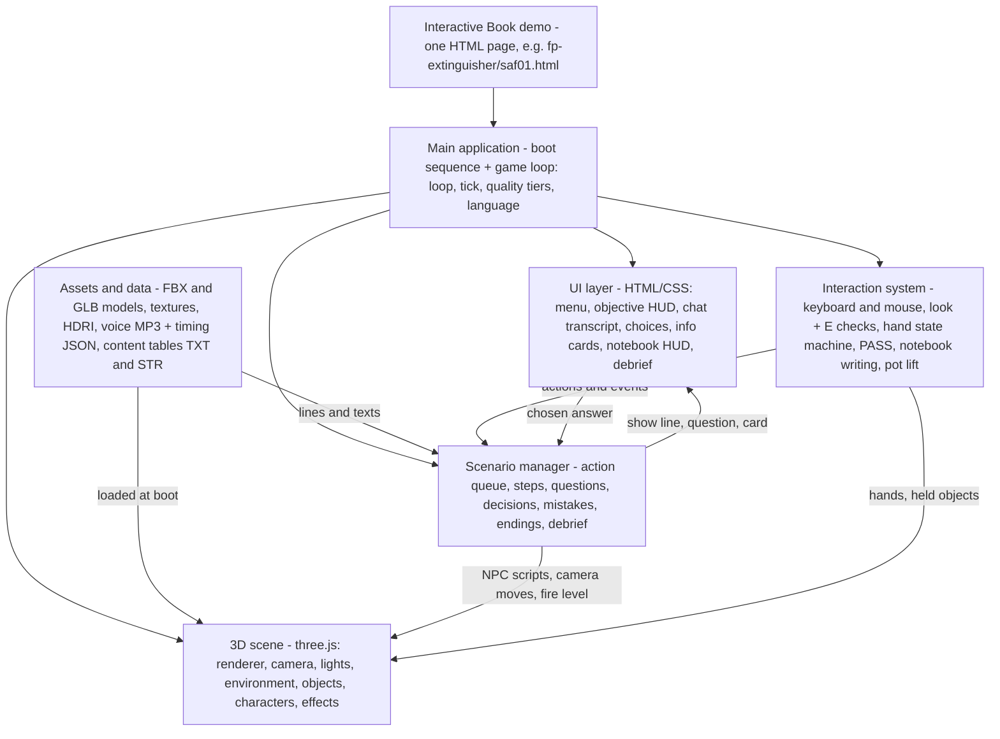
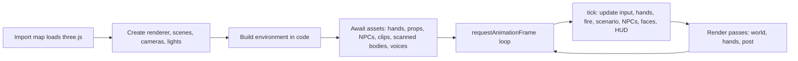
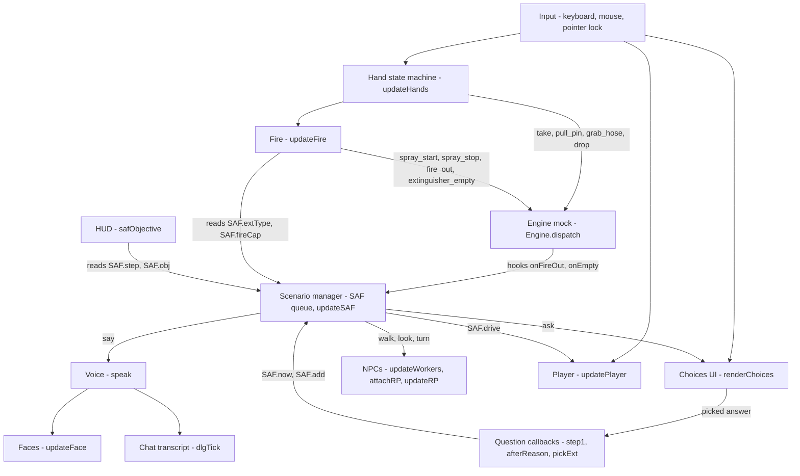
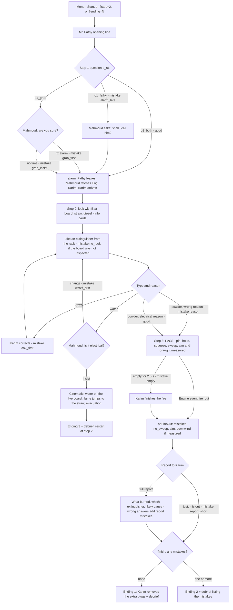
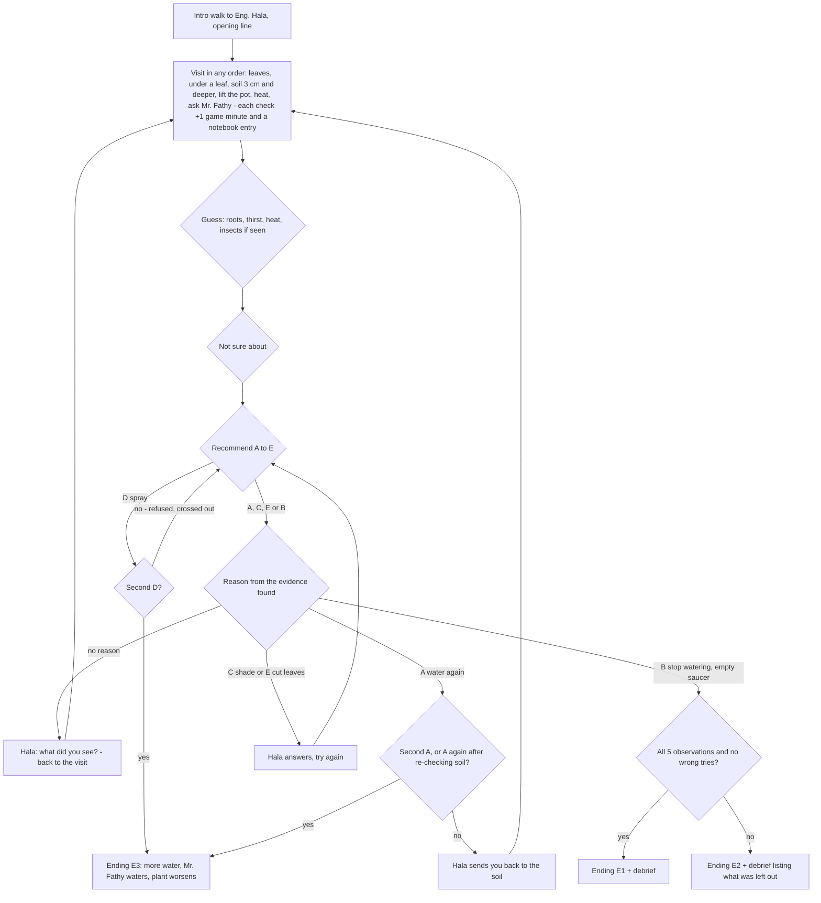
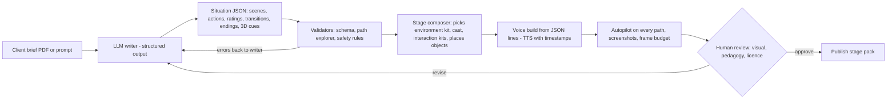
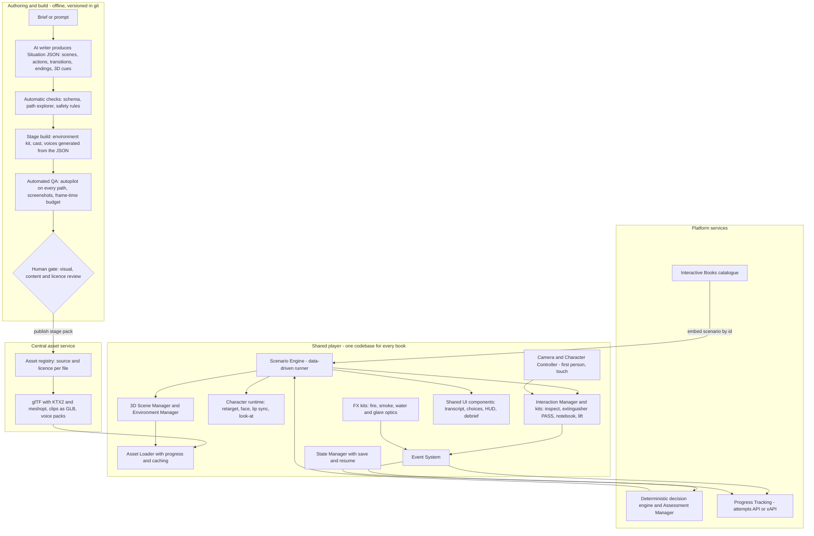

# Interactive Books 3D Demos: Technical Documentation (Reverse-Engineering Report) (detailed version)

> Detailed reference with code line numbers. The short, plain version is [TECHNICAL_DOCUMENTATION.md](TECHNICAL_DOCUMENTATION.md).

| | |
|---|---|
| Workspace analysed | `C:\book` (Windows), inspected on 2026-11-15 |
| Demos | SAF-01 *The Wrong Extinguisher* · AGR-03 *The Wilting Tomato* · AQ-01 *Still in Lane Four* · Extinguisher Drill (prototype) · Oil-pumpjack machine explorers |
| Companion files | [PROJECT_STRUCTURE.md](PROJECT_STRUCTURE.md) · [TECHNOLOGY_INVENTORY.md](TECHNOLOGY_INVENTORY.md) · [LOCAL_SETUP.md](LOCAL_SETUP.md) · [TECHNICAL_LIMITATIONS.md](TECHNICAL_LIMITATIONS.md) · [AI_INTEGRATION.md](AI_INTEGRATION.md) · [diagrams/](diagrams/) |

**Conventions**

- **Status labels.** **IMPLEMENTED**: present in the shipped file and working. **PARTIAL**: works but is simpler than the client brief. **EXPERIMENTAL**: present behind a URL switch and off by default. **PROPOSED**: future work that does not exist yet. **Not verified**: could not be confirmed from code or files.
- **Code references.** References are `path:line`, relative to `C:\book`. Every line number was taken from the code on 2026-11-15 by searching for the named function or constant. Where no line is given, the function name is the reference.
- **Two kinds of content.** Sections 1–8 describe the **current implementation**. Section 9 and every block marked **PROPOSED** describe future architecture.

---

## Project discovery: what exists and what does not

| Item looked for | Finding |
|---|---|
| `package.json` and other dependency manifests | **None** for the demos: no Node project, no `requirements.txt`, no lock files. The only manifest is inside a third-party research clone (`SplattingAvatar/requirements.txt`). |
| Build configuration (Vite, Webpack, tsconfig) | **None.** Every page is a hand-written `.html` with an inline `<script type="module">`. Libraries come from a CDN through an import map. |
| Entry points | One HTML file per demo: `fp-extinguisher/saf01.html`, `agr03.html`, `aq01.html`, `index.html`, plus `pumpjack/index.html`, `pumpjack-drill/index.html`, `pumpjack-field/index.html`. |
| Separate source modules | `fp-extinguisher/aq01/people.js`, `aq01/audio.js` (ES modules), and `fp-extinguisher/scenarios/saf01/src/*.js` (text fragments used by a build script; see 3.4). |
| Git repository | **No `.git` in `C:\book`.** There is no commit history. History exists only as 38 dated HTML snapshots (plus 7 PNG review images) in `fp-extinguisher/backups/`. Two third-party research repositories (`Gsplat-unity-virtual-human/`, `SplattingAvatar/`) are git clones, but they are not part of the demos. |
| Environment variables (names only) | `C:\book\.env` → `ELEVENLABS_API_KEY`. It is used only by an offline voice script, never by the games. `deploy/agr03/.env.local` and `deploy/saf01/.env.local` → `VERCEL_OIDC_TOKEN`, created by the Vercel CLI. **Values were not read into this document.** |
| Deployment configuration | `deploy/<game>/` folders with Vercel CLI project links (`.vercel/`). There is no `vercel.json`. |
| Backend, API, database | **None.** No server code exists. At runtime the only network traffic is static file `fetch`es plus the CDN and Google Fonts. |
| Existing documentation | `INTERACTIVE_3D_MACHINE_SPEC.md` (build spec for AI agents), `fp-extinguisher/SCAN_CHARACTER_GUIDE.md` (scan-to-character runbook, Arabic), `assets/polyhaven/LICENSE.md`, `assets/ROCKETBOX_LICENSE.md`, and an earlier submission in `submission/`. |

---

## SECTION 1: Demo Overview

### 1.1 What was built, in Interactive Book terms

Each demo is an **Interactive Book page rendered as a 3D world**. The table maps the usual parts of an Interactive Book to what actually exists in the code.

| Interactive Book element | How it exists in these demos | Status |
|---|---|---|
| A character that moves | The **learner** moves in first person (WASD + mouse). Their own **hands are visible** and do the work: pull a pin, touch soil, lift a pot, write. **NPC characters** are photo-scanned people animated by motion capture. They walk, look at whoever speaks and lip-sync. AGR-03's characters also gesture while talking. | IMPLEMENTED (SAF-01, AGR-03); procedural people in AQ-01 |
| An environment / virtual world | A farm shed (SAF-01), a school greenhouse (AGR-03), a 50 m competition pool hall (AQ-01) | IMPLEMENTED |
| Objects the user interacts with | Three extinguishers, the burning extension board, straw, a diesel drum (SAF-01); the tomato's leaves, the soil, the pot, a 3D notebook and pen (AGR-03); the lifeguard whistle and the chair (AQ-01) | IMPLEMENTED |
| An educational scenario | Each demo implements a client situation brief: steps, questions, decisions with reasons, consequences, endings, debrief | IMPLEMENTED (SAF-01, AGR-03); PARTIAL (AQ-01) |
| Animations and movement | Motion-capture clips, procedural IK for arms and fingers, faces with lip-sync from the voice, gestures, fire and water effects | IMPLEMENTED |
| AI for generating scenes or characters | **Used only during development:** an AI coding agent wrote the code, and a text-to-speech service generated the voices offline. **No AI runs inside the demos.** No AI-generated 3D models. | See Section 6 |

### 1.2 Demo cards

#### SAF-01: The Wrong Extinguisher

| Field | Value |
|---|---|
| Demo name | SAF-01 *The Wrong Extinguisher* (fire safety) |
| Purpose: what it teaches | Act correctly in a small electrical fire: **people and the alarm first**; read what is burning and what is near it; **choose the right extinguisher and say why** (dry powder for a live electrical board, never water); use it with **PASS** (pull the pin, aim at the base, squeeze, sweep, with the draught behind you); report what burned, which extinguisher, and the likely cause |
| Target users | First-year technical / agricultural students (client brief) |
| Live demo | https://instant-crystal-wnj8dit-islams-projects-5b27661f.vercel.app/ (HTTP 200 on 2026-11-15) |
| Repository | None yet. The code is not under version control. A private repository can be provided on request. |
| Source file | `fp-extinguisher/saf01.html` (286,888 B, 3,708 lines) |
| Status | **IMPLEMENTED end to end:** 3 steps, report, 3 endings, debrief, Arabic voices |

**Implemented features:**
- First-person movement.
- Inspect objects with **E**, which shows info cards.
- Take an extinguisher from the wall.
- Physical PASS with the mouse.
- Fire, smoke and agent particles. The fire shrinks where the agent lands, most near its base. Aim and sweep are scored as mistakes.
- Stress effects.
- 3 NPCs with motion capture, look-at and lip-sync.
- 43 voiced Arabic lines: 20 for the NPCs, 22 for the learner's own answers, 1 narration.
- Chat transcript.
- Numbered choices.
- 3 endings and a debrief listing your decisions and mistakes.
- Arabic and English interface.
- Autopilot demo.

**Missing or with issues:**
- No numeric score, no saved results, no LMS reporting. The "training engine" is a log.
- The ~10-minute time limit is not enforced.
- The ending-2 rule is simpler than the brief.
- English mode has subtitles only (no voices).
- Desktop only.
- Asset licence items are open.

#### AGR-03: The Wilting Tomato

| Field | Value |
|---|---|
| Demo name | AGR-03 *The Wilting Tomato* (agriculture) |
| Purpose: what it teaches | **Observe before acting.** Gather evidence (leaves, under a leaf, soil at two depths, pot and drainage, heat, asking the worker), keep a 5-box field notebook (*what I see / what I checked / my guess / what I'm not sure about / what I recommend*), and **match the remedy to the cause**. Wilting at noon is not thirst here: the pot can't drain. |
| Target users | Technical agriculture students aged 16–18 (client brief) |
| Live demo | https://fast-dune-d4l8zrv-islams-projects-5b27661f.vercel.app/ (HTTP 200 on 2026-11-15) |
| Repository | None yet (as above) |
| Source file | `fp-extinguisher/agr03.html` (226,913 B, 2,558 lines) |
| Status | **IMPLEMENTED end to end:** 5 steps, evidence rule, 3 endings, debrief with teacher scale, Arabic voices |

**Implemented features:**
- A greenhouse and a procedural tomato that droops.
- Each check costs 1 game minute.
- The hand touches the soil.
- The right hand lifts a leaf, then **both hands lift the pot** to show the blocked drainage hole.
- A **3D notebook written live**: the pen traces the letters, and rejected recommendations are crossed out.
- Recommendations A–E with Eng. Hala's spoken answers.
- Spraying is refused; a recommendation without evidence is sent back.
- 3 endings.
- A debrief with review questions, discussion questions and a 4-axis teacher scale. The game suggests a level on each axis.
- Mr. Fathy kneading soil.
- Gestures while talking.
- 40 voiced lines.

**Missing or with issues:**
- No numeric score or saved results; the suggested teacher scale is shown, not stored.
- English mode has subtitles only.
- Desktop only.

#### AQ-01: Still in Lane Four (work in progress)

| Field | Value |
|---|---|
| Demo name | AQ-01 *Still in Lane Four* (lifeguarding) |
| Purpose: what it teaches | Recognise **silent drowning**. A 13-year-old swimmer sinks without splashing while attention moves to the next race, and **surface glare** hides him from the seated lifeguard. The learner must notice, stop the next start, and (in later phases) rescue and hand over. |
| Target users | Lifeguards (client script SIT-AQ-LIFE-0001) |
| Live demo | Not deployed |
| Repository | None yet |
| Source files | `fp-extinguisher/aq01.html` (874 lines), `aq01/people.js` (1,159), `aq01/audio.js` (743) |
| Status | **PARTIAL: phase 1 of 4** |

**Implemented features:**
- A fully procedural pool hall (no asset files).
- Water with an approximate refraction pass (no true light bending), Fresnel reflection, waves and ripples.
- Glare from **real mirror geometry**: once the swimmer lies on the bottom, the reflection of the daylit window band hides him from the seat but not when you stand on the chair. On the deck it depends on where you stand.
- Procedural swimmers, officials and a crowd of 290.
- Synthesised hall sound.
- The race timeline.
- Whistle (F) and sit / stand / deck postures.
- 3 outcome cards.

**Missing:**
- Phase 2: the rescue in the water.
- Phase 3: voices and decision menus.
- Phase 4: the brief's five endings, scoring and the debrief.
- Some timing changes from the script still need the client's agreement.

#### Earlier demos (context)

| Demo | Purpose | Status |
|---|---|---|
| **Extinguisher Drill** (`fp-extinguisher/index.html`) | First-person extinguisher handling in a warehouse. The engine SAF-01 was generated from. | Prototype; no live link (its temporary deploy expired) |
| **Oil pumpjack machine explorer** (`pumpjack/`, `pumpjack-drill/`, `pumpjack-field/`) | Explore a machine: rotate, exploded view, cutaway, X-ray, guided tour, Arabic/English | IMPLEMENTED; no live link |

### 1.3 Feature status with code references

The tables below list what is implemented and where. References are `path:line`.

**SAF-01**

| Feature | Status | Reference |
|---|---|---|
| Bilingual UI (Arabic RTL default, English) | IMPLEMENTED | `STR` `saf01.html:235`, `applyLang` `:2984` |
| 43 voiced lines, positional audio, lip-sync from letter timings | IMPLEMENTED | `loadVoices` `:1145`, `speak` `:1160`, `updateFace` `:1225` |
| NPCs on Renderpeople bodies driven by Rocketbox motion capture | IMPLEMENTED | `WORKERS` `:942`, `attachRP` `:1081`, `updateRP` `:1119` |
| Inspect board / straw / diesel | IMPLEMENTED | `LOOKS` `:3186`, `lookTargets` `:3270`, `safUseE` `:3282` |
| Physical PASS (hand state machine) | IMPLEMENTED | `tryTake` `:2450`, `updateHands` `:2552` |
| Fire, smoke and agent particles | IMPLEMENTED | `PSys` `:2227`, `updateFire` `:2746` |
| Stress model | IMPLEMENTED | `updateEmotion` `:2864` |
| Transcript and choices | IMPLEMENTED | `DLG` `:3527`, `chatPick` `:3556`, `renderChoices` `:3561` |
| Endings + debrief | IMPLEMENTED | `finish` `:3420`, `showEnding` `:3425`, `renderEnding` `:3432` |
| Autopilot | IMPLEMENTED | `autoPick` `:3460`, `autoRun` `:3471` |
| Training engine | PARTIAL (mock log) | `Engine` `:2367` |
| Time limit | PARTIAL (`LIMIT` only feeds stress) | `LIMIT` `:2345` |
| Splat-scanned Karim / GLB hands | EXPERIMENTAL (`?karim=scan`, `?hand=`) | Karim's entry in `WORKERS`, `saf01.html:947`; `:3677` |

**AGR-03**

| Feature | Status | Reference |
|---|---|---|
| Greenhouse, props, HDRI | IMPLEMENTED | `loadModel` `agr03.html:427` |
| Procedural tomato, droop follows the story | IMPLEMENTED | `LEAF_SPEC` `:512`, `plantState` `:2257` |
| Checks: 1 game minute each, notebook entry | IMPLEMENTED | `useE` `:2145`, `checkStart` `:2152`, `tick1` `:2058`, `write` `:2057` |
| Hands with IK, soil touch | IMPLEMENTED | `loadHand` `:1116`, `solveArm` `:1211`, `handTouch` `:1262` |
| Pot lift with both hands | IMPLEMENTED | `potLift` `:1035`, `potLiftUpdate` `:1040` |
| 3D notebook written live | IMPLEMENTED | `nbDraw` `:1375`, `nbDraw2` `:1339`, `nbInk` `:1446`, `nbStripMake` `:1521`, `nbUpdate` `:1611` |
| Solved pen grip (`grip/tripod.json`) | IMPLEMENTED: loaded at every start; `gripFromHand` is the fallback | `loadGrip` `:1577`, fallback `gripFromHand` `:1567` |
| Kneading, gestures | IMPLEMENTED | `setupKnead` `:869`, `updateKnead` `:889`, `speechMarks` `:1234` |
| Voices + lip-sync (Arabic only) | IMPLEMENTED | `loadVoices` `:787`, `speak` `:801` |
| Recommendation + evidence rule | IMPLEMENTED | `askAction` `:2204`, `judge` `:2214` |
| Endings + debrief + suggested teacher scale | IMPLEMENTED (not stored) | `endingFor` `:2239`, `rubric` `:2266`, `renderEnding` `:2296` |

**AQ-01**

| Feature | Status | Reference |
|---|---|---|
| Procedural hall, water with refraction pass | IMPLEMENTED | `refrRT` `aq01.html:412` |
| Glare optics | IMPLEMENTED | `GLARE` `:172`, `glareCover` `:736` |
| Procedural people, crowd | IMPLEMENTED | `makeKid` `aq01/people.js:1016`, `makeAdult` `:1034`, `makeCrowd` `:1114` |
| Synthesised audio | IMPLEMENTED | `createHallAudio` `aq01/audio.js:24` |
| Timeline, whistle, outcome cards | IMPLEMENTED / PARTIAL | `at` `aq01.html:596`, `whistle` `:714`, `endPhase1` `:781` |

---

## SECTION 2: Technology Stack

### 2.1 Stack at a glance (only what is actually used)

| Part | What these demos use | Not used (checked) |
|---|---|---|
| Programming language | **JavaScript** (ES modules, top-level `await`), HTML, CSS. **Python** for offline scripts only. | TypeScript |
| Framework | **None.** Plain JavaScript; the UI is updated with `document.querySelector` / `innerHTML`. | React, Vue, Svelte |
| 3D engine | **Three.js 0.170.0**, loaded from `cdn.jsdelivr.net` through an import map | Babylon.js, Unity, PlayCanvas |
| 3D integration | **None.** Three.js is used directly. | React Three Fiber, drei |
| 3D loaders / helpers | Three.js addons: `GLTFLoader`, `FBXLoader`, `RGBELoader`, `RoomEnvironment`, `RoundedBoxGeometry`, `SkeletonUtils` (+ `OrbitControls` and `Sky` in the pumpjack demos, `BufferGeometryUtils` in AQ-01) | Draco, KTX2, meshopt |
| Animation | **Three.js `AnimationMixer`** playing Microsoft Rocketbox motion-capture clips, plus **custom code**: arm IK, finger curls, look-at, face and lip-sync, gestures, eased camera moves | GSAP, Theatre.js |
| Physics | **None.** Custom code: player collision against boxes, gravity and bounce for dropped items, particles | Rapier, Cannon.js, Ammo.js |
| Character / camera controller | **Custom** first-person controller with pointer lock (`updatePlayer`); `OrbitControls` in the pumpjack demos | Third-party controllers |
| State management | **None.** Plain JavaScript objects (`SAF`, `G`, `S`, `player`, `fire` …) | Zustand, Redux |
| UI | **HTML/CSS overlay** (HUD, chat, choices, debrief) + Canvas 2D for in-world text (notebook pages, signs) | UI component libraries |
| Audio | **Web Audio API** through three.js `AudioListener` / `PositionalAudio` (SAF-01, AGR-03). AQ-01 uses plain Web Audio: it synthesises every sound, with HRTF panning and a convolution reverb. | Howler.js |
| AI (inside the demo) | **None** | OpenAI, Gemini, any runtime model |
| AI (during development) | **Claude Code** (Anthropic) wrote the code; **ElevenLabs** TTS `eleven_v3` generated the voice files offline | — |
| 3D assets | Microsoft **Rocketbox** bodies and animations (MIT), **Poly Haven** textures, models and HDRI (CC0), **Renderpeople** scanned people (restricted licence), procedural geometry | AI-generated models |
| Backend / database | **None** | — |
| Build tools | **None** (no bundler). Offline helpers: Python 3.11, Blender 5.2 headless, Node 20, headless Chrome. | Vite, Webpack |
| Deployment | **Vercel** static hosting via the Vercel CLI | AWS, Netlify |
| Version control / CI | **None yet** | — |

### 2.2 Each technology: purpose, where it is used, what depends on it

Full version list: [TECHNOLOGY_INVENTORY.md](TECHNOLOGY_INVENTORY.md).

| Technology | Purpose | Where used | Depends on it | Essential / replaceable |
|---|---|---|---|---|
| JavaScript + HTML + CSS | The whole application | Every page | Everything | Essential |
| three.js 0.170.0 | Rendering, scene graph, loaders, animation mixer, audio wrappers | All 3D pages (import maps) | Every system | Essential. CDN delivery can be replaced by self-hosting. |
| `FBXLoader` | Rocketbox bodies and motion clips | SAF, AGR, Drill | NPCs, first-person hands | Replaceable (convert clips to GLB) |
| `GLTFLoader` | Renderpeople bodies, Poly Haven models | SAF, AGR | NPC bodies, props | Essential |
| `RGBELoader`, `RoomEnvironment` | HDRI sky and image-based light | SAF, AGR | Lighting | Replaceable |
| WebGL 2 | GPU rendering | All | All | Essential |
| Web Audio API | Voices (positional), synthesised ambience | SAF, AGR, `aq01/audio.js` | Voice, lip-sync | Essential |
| Pointer Lock API | Mouse-look | SAF, AGR, AQ | Player controller | Replaceable (drag or touch look) |
| Canvas 2D | Notebook pages, labels, signs, scoreboard | AGR notebook, SAF, AQ | Notebook | Essential for the notebook |
| Google Fonts | Arabic and Latin UI fonts, handwriting fonts | Page heads | UI, notebook | Replaceable (self-host) |
| localStorage | Language and quality preferences | All games | i18n, quality | Replaceable |
| Vercel | Static hosting | `deploy/saf01`, `deploy/agr03` | Live links | Replaceable |
| ElevenLabs TTS (offline) | Voice MP3 + per-letter timings | `gen_lines.py` (dev only) | `assets/audio/*` | Replaceable |
| Python / Blender / Node / headless Chrome | Asset conversion, voice generation, grip solver, screenshots and fps probes | Dev machine only | Assets, QA | Dev-only |

---

## SECTION 3: System Architecture

### 3.1 The architecture in layers (actual implementation)

Every demo is a **single HTML page**. Inside that page, the code is organised in numbered sections that form five logical layers around a main loop. The layers are **not separate files or classes**: they share one JavaScript module scope.



The full view, including the build-time tools and hosting: [diagrams/detailed/system-architecture.mmd](diagrams/detailed/system-architecture.mmd). The rendering and data flow: [diagrams/detailed/data-flow.mmd](diagrams/detailed/data-flow.mmd).

### 3.2 What each layer does and where its code is

| Layer | Responsibility | Main code: SAF-01 (`saf01.html`) | Main code: AGR-03 (`agr03.html`) | AQ-01 (`aq01.html`) |
|---|---|---|---|---|
| **Main application** | Boot: create the renderer, build the world, load assets in order, start the loop. Every frame: update all systems in a fixed order, then render. | sections 1 (`:288`) and 18 (`:3585`): `tick` `:3588`, `loop` `:3653` | sections 1 (`:223`) and 9 (`:2364`): `tick` `:2500`, `loop` `:2515` | section 12 (`:804`): `tick` `:830`, `loop` `:867` |
| **UI layer** | Everything drawn in HTML on top of the 3D view: menu, language switch, objective, chat transcript, numbered choices, info cards, endings / debrief | `DLG` `:3527`, `renderChoices` `:3561`, HUD section 15 (`:2925`), menu section 16 (`:2976`), `renderEnding` `:3432` | `DLG` `:2369`, `renderChoices` `:2404`, `renderBook` `:2410`, `renderEnding` `:2296` | `say` `:590` (chat), `endPhase1` `:781` |
| **3D scene** | Renderer, camera, lights, environment geometry, props, characters (bodies, animation, faces), effects (fire, smoke, water) | sections 1–3 (`:288`, `:345`, `:453`), NPCs section 5b (`:930`), particles section 6 (`:2218`), fire section 12 (`:2742`) | sections 1–5 (`:223`–`:617`): greenhouse, tomato, people | sections 1–6 (`:147`–`:496`), `aq01/people.js` |
| **Interaction system** | Read keyboard and mouse, decide what the learner is looking at, run the hands, turn physical actions into events | input section 9 (`:2392`), `lookTargets` `:3270`, `safUseE` `:3282`, hand state machine section 10 (`:2442`) | input `:954`, `lookTargets` `:2133`, `useE` `:2145`, hands and notebook section 7 (`:1092`) | `whistle` `:714`, `updateGaze` `:727`, `updatePlayer` `:746` |
| **Scenario manager** | Hold the scenario state, run the queue of lines and questions, evaluate answers, record decisions and mistakes, choose the ending | situation module (`:3049`): `SAF` `:3194`, `updateSAF` `:3231`, `afterReason` `:3294`, `finish` `:3420` | situation section 8 (`:1893`): `G` `:2044`, `updateFlow` `:2079`, `judge` `:2214`, `endingFor` `:2239` | `S` `:536`, `at` `:596` (timeline) |
| **Assets and data** | Static files fetched at boot, plus the content tables inside the page | `assets/…`, `TXT` `:3086`, `MIST` `:3125`, `ENDINGS` `:3142` | `assets/…`, `grip/tripod.json`, `TXT` `:1926`, `ENDINGS` `:2010`, `RUBRIC` `:2029` | none (procedural), `LINES` `:121` |

### 3.3 Project folder structure

```
C:\book
├─ fp-extinguisher/            scenario games (web root)
│  ├─ saf01.html  agr03.html  aq01.html  index.html (prototype)
│  ├─ aq01/people.js  aq01/audio.js
│  ├─ grip/tripod.json         offline-solved pen grip (AGR-03)
│  ├─ assets/                  anim/ audio/ polyhaven/ renderpeople/ Rocketbox bodies …
│  ├─ scenarios/saf01/         old build script + fragments (out of date)
│  ├─ tools/                   scan tools, screenshot and fps scripts
│  └─ backups/                 dated HTML snapshots
├─ pumpjack/ pumpjack-drill/ pumpjack-field/   machine explorers
├─ deploy/saf01  deploy/agr03  copies published to Vercel
└─ INTERACTIVE_3D_MACHINE_SPEC.md              build spec for AI agents
```

Full description of every folder and file: [PROJECT_STRUCTURE.md](PROJECT_STRUCTURE.md).

### 3.4 Components: what each one does

Section map of SAF-01. Banner lines verified; AGR-03 follows the same layout.

| Banner line | Component | What it does | Key symbols |
|---|---|---|---|
| 233 | Text | Arabic / English strings, language switch | `STR` (235), `applyLang` (2984) |
| 288 | Quality + renderer + scenes | Renderer, world and hands scenes, cameras, lights, quality tier | — |
| 345 | Helpers | Mesh and canvas-texture helpers | `mk` (347), `canvasTex` (360) |
| 453 | Farm shed | Builds the environment; Poly Haven materials and props | `pbr` (473), `uvM` (483), `loadModel` (598) |
| 762 | Extinguisher | The extinguisher model with grip points | — |
| 814 | Procedural hands | Fallback hands and arm IK | `solveArm` (911) |
| 930 | Rocketbox hands + NPCs | Characters: animation clips, scanned bodies, voices, faces, look-at | `WORKERS` (942), `loadClip` (951), `loadWorkers` (957), `updateWorkers` (1009), `attachRP` (1081), `updateRP` (1119), `loadVoices` (1145), `speak` (1160), `setupFace` (1185), `updateFace` (1225), `npcLook` (1254) |
| 2218 | Particles | Flames, smoke, extinguishing agent | `PSys` (2227) |
| 2343 | Simulation state | Global state objects | `sim` (2346), `player` (2347), `fire` (2348), `H` (2351) |
| 2365 | Engine (mock) | Receives action events; logs them | `Engine` (2367) |
| 2392 | Input | Keyboard, mouse, pointer lock | `keydown` listener (2394), `lock` (2438) |
| 2442 | Hand state machine | Take, pin, hose, squeeze, drop | `tryTake` (2450), `updateHands` (2552) |
| 2672 | Player | Movement and collision | `updatePlayer` (2692) |
| 2742 | Fire + spray + smoke | Fire health, agent hits, smoke | `updateFire` (2746) |
| 2862 | Emotion | Stress from fire, smoke, time | `updateEmotion` (2864) |
| 2925 / 2976 | HUD / menu | Objective, timer, menu | `safObjective` (3569) |
| 3049 | Situation module | The scenario: content, queue, steps, endings, transcript, autopilot | `TXT` (3086), `SAF` (3194), `updateSAF` (3231), `finish` (3420) |
| 3585 | Main loop | Per-frame update and render | `tick` (3588), `loop` (3653) |

AGR-03 adds two components SAF-01 does not have:
- **Notebook + pen writing** (section 7 from `:1092`): `NB` (1283), `nbDraw` (1375), `nbInk` (1446), `nbStripMake` (1521), `nbUpdate` (1611), `updateHand` (1788).
- **Pot lift**: `potLift` (1035).

AQ-01 is the only demo that keeps components in separate files: `aq01/people.js` and `aq01/audio.js`, loaded with `import()` at `aq01.html:499` and `:771`.

**How the files were derived from each other:**
- SAF-01 was first **generated** from the Extinguisher Drill (`index.html`) by `fp-extinguisher/scenarios/saf01/build_saf01.py`. The script replaces text at exact-match anchors with the fragments in `scenarios/saf01/src/*.js`.
- After that, SAF-01 was **edited directly**: voices, the chat transcript, Renderpeople bodies, new fire. The script no longer reproduces the shipped file.
- AGR-03 was made by **copying** systems from SAF-01 and adding new ones: 63 function names are shared, and 27 of those functions are nearly identical (bodies at least 95 % similar).

### 3.5 How the 3D scene is drawn

1. **Load:** the import map resolves `three` from jsDelivr.
2. **Set-up:** the module's top-level code creates the `WebGLRenderer` (ACES tone mapping, soft shadows), the scene(s), cameras and lights, and picks the quality tier (`?q=` or the saved preference).
3. **Build:** the environment is built **in code** (walls, benches, pool), with Poly Haven textures and models.
4. **Boot loading, in stages:** the hands, the props, the NPC bodies and animation clips, the scanned bodies (`attachRP`), the voices. Each stage waits for the one before it, while the files inside a stage load in parallel (`Promise.all`). Nothing is drawn until all stages finish, and there is no progress bar.
5. **Loop:** `requestAnimationFrame` → `loop` → `tick(dt)` with `dt` capped at 0.05 s.
6. **Update order:** each `tick` updates input/player → hands → fire/effects → scenario queue → NPCs → scanned bodies and faces → HUD.
7. **Render:**
   - **SAF-01:** world pass → (experimental splat pass) → clear depth → **hands pass** (own lights, so hands never clip into walls) → vignette/grain pass.
   - **AGR-03:** world pass → vignette/grain pass.
   - **AQ-01:** **refraction pass** of the pool into a render target → main pass with the water shader.



### 3.6 How the state changes

State lives in plain JavaScript objects. Any section can read or change them; there is no store and no change notification.

| Game | State objects (line) | What they hold |
|---|---|---|
| SAF-01 | `SAF` (3194) | Step, objective, action queue, current question and answer, decision log, mistakes, inspected objects, chosen extinguisher, ending flags |
| | `sim` (2346), `player` (2347), `fire` (2348), `emo` (2350), `H` (2351), `pass` (2358), `stats` (2359), `input` (2360) | Clock, position, fire health, stress, hand state, PASS progress, aim statistics, keys |
| AGR-03 | `G` (2044) | Phase, game clock, action queue, notebook boxes `book`, evidence `ev`, checks seen, tries, counters for wrong answers, current answer |
| | `NB` (1283), `HAND` (1101), `POTA` (1032), `GEST` (1232) | Notebook and pen, hand animation, pot lift, gestures |
| AQ-01 | `S` (536), `P` (699), `GZ` | Session clock, heats, events log, whistle; player posture; gaze |

**Example 1, a decision (SAF-01): the learner takes the water extinguisher.**
1. The `keydown` listener (`saf01.html:2394`) sees **E**. `safUseE` (`:3282`) → `pickExt('water')` (`:3288`) puts a "why?" question at the front of the queue with `SAF.now` (`:3201`).
2. On the next frame `updateSAF` (`:3231`) starts that item. `qStart` (`:3214`) sets **`SAF.choice`** and `renderChoices` (`:3561`) draws the numbered buttons.
3. The learner presses **1**. `SAF.pick` (`:3202`) sets **`SAF.picked`**. `qDone` (`:3220`) is now true, and `qEnd` (`:3227`) calls the question's callback, `afterReason('water', 0)` (`:3294`).
4. `afterReason` calls `decide('pick_water', false)`, which adds to **`SAF.log`**. It then queues Mahmoud's line "is it electrical?" and a change/insist question.
5. The `say` item calls `speak` (`:1160`): the voice plays from Mahmoud's head, **`SAF.speech`** drives his lips (`updateFace` `:1225`), and the transcript reveals the words.
6. **Change** → `mistake('water_first')` (`:3210`) adds to **`SAF.mistakes`**. **Insist** → **`SAF.insisted = true`** → `takeExt('water', true)` (`:3318`) plays the cinematic → `adverse` (`:3334`) raises the fire and shows ending 3.
7. At the end, `finish` (`:3420`) reads `SAF.insisted` and `SAF.mistakes` to choose the ending.

**Example 2, a physical check (AGR-03): the learner touches the soil.**
1. Every frame `lookTargets` (`agr03.html:2133`) sets **`G.target`** to the object in view and in reach.
2. **E** → `useE` (`:2145`) → `checkSoil` (`:2164`).
3. `checkStart` (`:2152`) sets **`G.busy`**, adds `soil` to **`G.seen`**, and calls `tick1` (`:2058`), so **`G.clockMin`** gains one game minute.
4. Queued items run `handTouch` (`:1262`). That sets **`HAND.anim`**, so `updateHand` (`:1788`) pushes the index finger into the soil with IK. An info card follows, then "deeper?".
5. The learner picks a note. `write('did', 'soil', …, 'damp')` (`:2057`) stores it in **`G.book.did`** and the evidence in **`G.ev`**, and sets **`NB.dirty`**. The 3D notebook comes up and the pen writes the line (`nbUpdate` `:1611`). The HUD copy is refreshed by `renderBook` (`:2410`).
6. Later, `askAction` (`:2204`) builds the reason options from `G.ev`, and `endingFor` (`:2239`) checks `G.seen` to choose E1 or E2.

### 3.7 How the components talk to each other

There is no framework, no event-emitter library and no store. Components communicate through six mechanisms:

| Mechanism | How it works | Example |
|---|---|---|
| Direct function calls | One section calls another's function | `useE` → `checkSoil`; `afterReason` → `takeExt` |
| Shared state objects | One section writes a global object; others read it every frame | `updateFire` reads `SAF.extType` / `SAF.fireCap`; the HUD reads `SAF.obj` through `safObjective` (`saf01.html:3569`) |
| The scenario queue | Any code pushes items (`say`, `ask`, `wait`, `until`, `run`; AGR-03 adds `card`); the scenario manager runs them in order | `SAF.add` / `SAF.now` (`saf01.html:3200-3201`); `add` / `now` (`agr03.html:2050`) |
| Engine events | Physical actions are reported as events by the hands, the fire and the emotion model. The mock engine logs them and shows the last 6 on screen. Two events call scenario hooks. | `fire_out` → `SAF.onFireOut` (`saf01.html:3397`); `extinguisher_empty` → `SAF.onEmpty` (`:3414`) |
| Polling | Conditions checked every frame | `SAF.watches`; `{ until: () => … }` queue items |
| DOM events | Buttons and keys go to handlers; the UI is redrawn with `innerHTML` | choice buttons → `SAF.pick` (`saf01.html:3561`) |

Component interaction in SAF-01:



**Network communication:** none at runtime apart from loading static files (models, textures, audio, `grip/tripod.json`) and the CDN libraries and fonts. There is no backend API.

### 3.8 Section maps of AGR-03 and AQ-01

| AGR-03 banner | Section | Key symbols |
|---|---|---|
| 203 | Text | `STR` (205) |
| 223 | Quality + renderer | — |
| 289 | Greenhouse | `loadModel` (427) |
| 450 | Tomato | `POT` (454), `LEAF_SPEC` (512) |
| 617 | People | `WORKERS` (625), `loadClip` (631), `npcLook` (700), `attachRP` (746), `loadVoices` (787), `speak` (801), `setupFace` (826), `setupKnead` (869), `updateFace` (901), `updateRP` (929) |
| 946 | State + input + player | `sim` (950), `player` (951), `updatePlayer` (987), `potLift` (1035) |
| 1092 | Hands, notebook, grip, writing | `HAND` (1101), `loadHand` (1116), `solveArm` (1211), `NB` (1283), `nbDraw` (1375), `nbInk` (1446), `loadGrip` (1577), `nbUpdate` (1611), `updateHand` (1788) |
| 1893 | The situation | `TXT` (1926), `ENDINGS` (2010), `RUBRIC` (2029), `G` (2044), `updateFlow` (2079), `useE` (2145), `judge` (2214), `endingFor` (2239), `Engine` (2361) |
| 2364 | HUD + menu + loop | `DLG` (2369), `renderChoices` (2404), `tick` (2500), `loop` (2515) |

| AQ-01 banner | Section | Key symbols |
|---|---|---|
| 100 | Text | `STR` (103), `LINES` (121) |
| 147 | Renderer + constants | `POOL` (165), `CHAIR` (168), `GLARE` (172) |
| 175 | Materials | `tileMat` (191) |
| 254 | Hall | — |
| 397 | Light | `cubeRT` (404) |
| 408 | Water | `refrRT` (412) |
| 496 | People | `import('./aq01/people.js')` (499), `standIn` (501) |
| 531 | Session | `S` (536), `updateRayan` (571) |
| 587 | Flow | `say` (590), `at` (596) |
| 697 | You | `P` (699), `whistle` (714), `updateGaze` (727), `glareCover` (736), `updatePlayer` (746) |
| 768 | Audio | `import('./aq01/audio.js')` (771) |
| 778 | End | `endPhase1` (781) |
| 804 | Start, demo, loop | `tick` (830), `loop` (867) |

### 3.9 Events and asset loading

- **Event types sent to `Engine.dispatch` (SAF-01, 19):** `take_extinguisher`, `pull_pin`, `pin_slip`, `grab_hose`, `release_hose`, `spray_start`, `spray_stop`, `drop_extinguisher`, `too_close`, `extinguisher_empty`, `fire_out`, `alarm`, `inspect`, `choose_extinguisher`, `decision`, `mistake`, `flame_jumped`, `report`, `ending`. AGR-03 sends `check`, `recommend` and `ending`.
- **Asset loading:**
  - Staged `await`s in the boot block: SAF-01 `saf01.html:3675-3705`, AGR-03 `agr03.html:2530-2555`. Inside a stage the files load in parallel; the shed's props and textures start loading as soon as the module runs.
  - The render loop starts only when all of them have finished.
  - Caching is the browser's HTTP cache only.
  - AQ-01 loads its two modules with `import()` inside `try/catch`. If a module fails, simple stand-ins are used (people) or the game runs silent (audio).

---

## SECTION 4: 3D World Construction

### 4.1 From initialisation to the rendered scene

Initialisation runs in this order (SAF-01; AGR-03 is analogous):
1. The import map resolves `three`.
2. Renderer, scenes, cameras and lights are created, and the quality tier is chosen.
3. Procedural world geometry is built synchronously.
4. Boot awaits load the assets: fonts → hands → Poly Haven props → Rocketbox NPC bodies and clips → Renderpeople bodies (`attachRP`) → voices → extinguisher rack.
5. The `requestAnimationFrame` loop starts.
6. Each `tick` updates the systems in a fixed order, then renders the passes shown in 3.5.

### 4.2 Environments, objects and construction method

| Demo | Environment | Construction | Assets |
|---|---|---|---|
| SAF-01 | Corrugated-iron farm shed with an office; daylight through the door and a window | **Procedural** geometry in code (walls, openings, gables, rafters, posts). Story objects are built in code: overloaded extension board, plugs, cables, scorch mark, straw sacks, bales, instanced loose straw, cobwebs, light shafts. | Poly Haven textures (`pbr` `saf01.html:473`, metre-based UVs `uvM` `:483`), Poly Haven glTF props (`loadModel` `:598`), HDRI `belfast_farmhouse_2k` |
| AGR-03 | 10 × 7 m school greenhouse with benches | Procedural structure. **Procedural tomato**: stem curve, leaves from `LEAF_SPEC` (`agr03.html:512`), pot, soil, saucer water, thermometer. | Poly Haven textures, HDRI, 5 glTF props (`loadModel` `:427`) |
| AQ-01 | 50 m 8-lane pool hall, stands, warm-up pool | **100 % procedural, no asset files.** Canvas-drawn block numbers and scoreboard; GLSL tiles and caustics (`tileMat` `:191`). | None |
| Pumpjack explorers | Oil pumpjack and drilling rig | **100 % procedural** from primitives. `Part` class (`pumpjack/index.html:504`), analytic kinematics `solve` (`:1213`). | None |

**Manual, procedural or AI-generated?** All environments are **procedural code written with an AI coding assistant**, combined with library assets. **No 3D asset in the shipped demos was produced by a generative AI model.** There is one exception, experimental and never deployed: the `?karim=scan` option in SAF-01 uses research body scans that an AI tool (LHM) rebuilt from AI-generated images (`assets/fullbody/`, research-only licence).

### 4.3 Characters

1. **Animation source:** a Microsoft Rocketbox FBX body (MIT), loaded hidden, plays Rocketbox motion-capture clips (`assets/anim/*.fbx`) through `AnimationMixer`. `loadClip` filters tracks to rotations plus the pelvis.
2. **Visible body:** a Renderpeople photo-scanned GLB.
   - `attachRP` (`saf01.html:1081`, `agr03.html:746`) maps bones through `RP_MAP` and stores per-bone rest-pose deltas.
   - `updateRP` (`saf01.html:1119`, `agr03.html:929`) copies rotations every frame and scales the hip height.
3. **Face:** the jaw, eyelids, eyes and mouth-corner bones of the scanned rig are driven procedurally (`setupFace`, `updateFace`), with blinks and saccades.
4. **Materials:** colour, normal, roughness and baked AO maps, with roughness scaled up so cloth does not look satin. The AO was baked offline in Blender.

| Game | Character | Visible body |
|---|---|---|
| SAF-01 | Mahmoud | Renderpeople manuel |
| SAF-01 | Mr. Fathy | Renderpeople nathan |
| SAF-01 | Eng. Karim | Renderpeople eric |
| AGR-03 | Eng. Hala | Renderpeople sophia |
| AGR-03 | Mr. Fathy | Renderpeople nathan, with the mud texture `nathan_color_mud.jpg` |
| AQ-01 | swimmers and officials; crowd | swimmers and officials are procedural single-mesh skinned characters (18 bones). The crowd is instanced, non-skinned figures with a shader sway (`aq01/people.js`). |

**First-person hands.** The Rocketbox `Male_Adult_01` forearms and hands use two-bone IK (`solveArm`) and per-joint finger curls. A procedural fallback exists in SAF-01, section 5. AGR-03 adds a JSON grip (`grip/tripod.json`) produced by an offline optimiser.

### 4.4 Asset sources, formats, loading

| Asset set | Format | Source / licence | Loader | Used by |
|---|---|---|---|---|
| `assets/Construction_*`, `Male_Adult_01`, `anim/` | FBX + JPG | Microsoft Rocketbox, MIT (`assets/ROCKETBOX_LICENSE.md`) | `FBXLoader` (parsed at runtime) | SAF, AGR, Drill |
| `assets/polyhaven/` | JPG, glTF + bin, HDR | Poly Haven, CC0 (`assets/polyhaven/LICENSE.md`) | `TextureLoader`, `GLTFLoader`, `RGBELoader` | SAF, AGR |
| `assets/renderpeople/` | GLB + 2K JPG | Renderpeople free samples. **No licence file in the folder; terms not verified from files.** | `GLTFLoader` | SAF, AGR |
| `assets/audio/{saf01,agr03}/` | MP3 + JSON timings + `manifest.json` | ElevenLabs output | `fetch` + `decodeAudioData` | SAF, AGR |
| `grip/tripod.json` | JSON | Generated offline | `fetch` | AGR |
| `assets/sketchfab/rigged_hand.glb`, `assets/meta/*.glb` | GLB | Sketchfab CC-BY-SA (glTF metadata) / provenance unknown | `GLTFLoader` | Drill; SAF behind `?hand=` (EXPERIMENTAL) |
| `assets/fullbody/`, `assets/splat/`, `assets/avatar/` | Gaussian splat, SH tables, GLB | Personal scans + research-only sample bodies | custom splat loader (worker) | Drill, R&D pages; SAF behind `?karim=scan`. **Not deployed.** |

Caching: browser HTTP cache only. There is no service worker and no asset hashing.

### 4.5 Camera, movement, navigation, animation

- **Camera:** first-person perspective, FOV 68–70°, eye height 1.62–1.65 m, crouch, head bob, stress tremor (SAF).
  - AGR-03's writing view is one minimum-jerk camera move with FOV 68→38 to a fixed notebook view.
  - AQ-01 has postures: seat 2.37 m, stand 3.19 m, deck 1.76 m (`EYE`, `aq01.html:700`).
  - Pumpjack uses `OrbitControls` with `flyTo` (`pumpjack/index.html:1251`).
- **Movement and navigation:** WASD relative to the view (`updatePlayer`). There is no navmesh. NPCs follow waypoint scripts and stop for, or walk around, the player. The autopilot drives the same controller (`SAF.drive`).
- **Animation:** Rocketbox clips through `AnimationMixer`, plus procedural layers: IK, finger curls, look-at (`npcLook`), gestures (`GEST`), kneading (`updateKnead`), and minimum-jerk camera moves.

### 4.6 Physics and collision

**No physics engine is used.** Custom code covers:
- **Player collision:** a circle (r 0.28 m) against wall bounds, boxes, NPC circles and a no-go radius around the fire (SAF section 11).
- **Dropped objects:** gravity and bounce for the pin and the extinguisher (section 14).
- **Particles:** drag and gravity on agent particles. Hits inside the fire volume reduce fire health, and hits below 0.8 m do about 7× more damage. The PASS "aim" score is separate: it uses the camera direction to the base of the fire.
- **Water drops** under gravity (AGR pot lift).
- **Casualty motion** (AQ): drift, roll, sink (`updateRayan` `aq01.html:571`).

### 4.7 Lighting, shadows, rendering configuration

- **Tone mapping and shadows:** ACES Filmic tone mapping and PCF soft shadows (2048 px at high quality, 1024 px at low).
- **Environment light:** PMREM environment from an HDRI or `RoomEnvironment`. Hemisphere and directional sunlight, with the sun aligned to the HDRI.
- **SAF-01 lights:** bounce lights, bulbs and a flickering fire light.
- **AQ-01 lighting:** hemisphere light, a sun with a 2048² shadow map, and a hall cube capture used for reflections.
- **Post-processing:** a custom full-screen vignette and grain shader. There is no EffectComposer and no bloom.

### 4.8 Performance optimisations (verified in code)

| Technique | Location |
|---|---|
| Quality tiers low/high: pixel ratio, shadow size, particle counts, decorative layers | SAF section 1, AGR section 1 |
| Separate hands pass; HUD every 3rd frame; emotion model every 1–2 frames | SAF `tick` `:3588` |
| Instanced meshes: loose straw, bolts, crowd | SAF section 3, pumpjack, `aq01/people.js` `makeCrowd` |
| Transmission glass replaced by plain glass; the code comment explains that transmission forces a re-render of the scene | SAF `:601` |
| Notebook ink written to small opaque strip meshes, so the page texture is re-uploaded only when a note ends | AGR `nbStripMake` `:1521` |
| Pixel ratio cap; refraction target at 0.6× resolution | all; AQ |
| `?perf` probe writing `window.__perf` (GPU name, fps, frame times) | SAF `:3663`, AGR |

**Measured performance:** Not verified in this analysis (no profiling was run). Project notes record ~47 fps for SAF-01 on an Intel HD 630 integrated GPU. A code comment in AGR-03 records a ~40 ms cost for a full notebook-page texture upload on the same GPU.

---

## SECTION 5: Scenario & Interaction System

### 5.1 Representation of educational content

Content is held in **JavaScript object literals inside each game file**:
- Bilingual line table `TXT` (`[arabic, english]` pairs): SAF `:3086`, AGR `:1926`.
- UI strings `STR`.
- Endings `ENDINGS`.
- SAF-01: the mistake catalogue `MIST` (`:3125`).
- AGR-03: `REVIEW`, `DISCUSS`, `RUBRIC` (teacher scale) and `EV_REASON` (evidence → reason), at `:2009-2029`.
- AQ-01: `LINES` (`:121`).

There is **no external scenario file, schema or database**.

### 5.2 Initialisation, steps and progression

- **Initialisation:** `startFlow` (SAF `:3347`) reads `?step=` and `?ending=`, positions the NPCs and enqueues the opening line and the step-1 question. AGR-03 starts with an intro walk to Eng. Hala.
- **Steps:** these are not data structures. A step is a value of `SAF.step` / `G.phase` plus an objective key (`SAF.obj`) shown in the HUD.
- **Progression engine:** a **queue runner**.
  - Item types: `{say, k, d}` speak a line, `{ask, who, qk, opts, best, cb}` ask a question, `{card}`, `{wait}`, `{until, max}` wait for a predicate with a timeout, `{run}` call a function.
  - `SAF.add` appends and `SAF.now` prepends.
  - Each tick processes up to 60 items (`updateSAF` `:3231`; AGR `updateFlow` `:2079`).
  - `SAF.watches` holds polled predicates.
  - Sim time drives the queue, so the headless fast-forward (`?warm=N`) behaves identically.
- **AQ-01:** a **time-based timeline** instead of a queue. `at(t, fn)` (`:596`) schedules events by session time (1.5–33 s), and `atT` (`:597`) schedules them relative to T0, the moment the casualty starts sinking. The calls are at `:600-616`. After the whistle, later events do nothing (`S.stopped`), and the session ends 3.2 s later.

### 5.3 User actions, interactive objects, decisions

- **Objects become interactive** through "look + reach" definitions. `LOOKS` (SAF `:3186`, AGR `:2124`) gives each object a point and a reach radius. A shared view-angle threshold decides what you are looking at, and **E** triggers the matching check (`useE`, AGR `:2145`). There is no generic raycast-based interaction manager.
- **Physical actions** go through the hand state machine (SAF section 10), which emits `Engine` events.
- **Decisions** are `ask` items. The selected option calls the item's callback (`cb`), and the callback evaluates it inline.
  - `afterReason` (SAF `:3294`): water triggers Mahmoud's "is it electrical?"; CO₂ triggers Karim's correction; powder with the electrical reason is good.
  - `judge` (AGR `:2214`):
    - D (spray) is refused; the second D gives ending 3.
    - A recommendation with no reason gives "what did you see?".
    - The first A sends the learner back to the soil; a second A gives ending 3.
    - C and E give a reply, then another try.
    - B leads to E1 or E2.
- **Outcome generation:**
  - SAF `finish` (`:3420`): `insisted ? 3 : mistakes.length ? 2 : 1`.
  - AGR `endingFor` (`:2239`): E1 if all five observations were made (`missing`, `:2233`) and there were no wrong tries; otherwise E2. E3 comes from `judge`.
  - AQ `endPhase1` (`:781`): a whistle within 25 s; a whistle before heat 4 dives in (T+60); otherwise "not noticed". The session ends on its own at T+170 (`:846`). A whistle before T0 counts as a false alarm and play continues.

### 5.4 Scenario lifecycle (SAF-01, as implemented)

Source: [diagrams/detailed/scenario-flow.mmd](diagrams/detailed/scenario-flow.mmd).



AGR-03 lifecycle (as implemented in `useE`, `checkStart`, `askAction`, `judge`, `endingFor`, `finish`):



### 5.5 Feedback, assessment, learning objectives

- **Feedback:**
  - Diegetic, through characters' spoken lines (Mahmoud, Karim, Hala).
  - Physical consequences: the fire reacts to aim and sweep; the flame jumps to the straw in E3; the saucer water rises in AGR E3.
  - Toasts for technique, such as the draught warning.
  - The end-of-scenario debrief.
- **Assessment:**
  - **No numeric score or grade exists.**
  - SAF-01 records each decision as good or poor (`decide` `:3211`) and a unique mistake list (`mistake` `:3210`). The debrief lists both.
  - AGR-03 shows a 4-axis × 3-level **teacher rubric**. `rubric` (`:2266`) computes a suggested level per axis from the evidence, the guess, the tries and how the worker was asked, and highlights it. It is not stored.
  - AQ-01 shows a timeline table.
- **Learning objectives** are represented only as text: the steps HUD (3 steps in SAF, 5 in AGR) and the "lesson" and "limits" paragraphs on the debrief. They are not machine-readable competencies.

### 5.6 Reuse vs hard-coding

| Category | Items |
|---|---|
| **Reusable interaction logic (generic code today)** | Queue runner semantics; voice + letter-timed lip-sync; face driver; Renderpeople retargeting; NPC clip/script system with `attend` / `npcLook`; first-person hands + IK + JSON grips; notebook writing; transcript and choices UI; post shader; quality tiers; test hooks (`tick(n)`, `?warm`, `__perf`) |
| **Hard-coded scenario behaviour** | All text and endings; every branch as a JS callback; all world coordinates (objects, NPC paths, `LOOKS` reach boxes, `AUTO_PLAN`); thresholds (aim, sweep, draught, gaze 7° / 0.6 s, whistle 25 s / 170 s); grip constants (`POT_AIM`) |
| **Tightly coupled to the current demo** | `updateFire` ↔ `SAF.extType` / `SAF.fireCap`; HUD ↔ `safObjective`; `Engine` ↔ `SAF.onFireOut` / `SAF.onEmpty`; `gen_lines.py` ↔ the HTML text format (regex) |
| **Opportunities for configuration-driven scenarios** | Line tables → JSON; steps and questions → scene and action records; mistakes → rule table; object interactions → per-object config (reach, card, kit); NPC cast and paths → stage data; fire-class vs agent rules → table |

### 5.7 Test and debug hooks (all shipped in production)

| Game | URL parameters | Examples | Window hooks |
|---|---|---|---|
| SAF-01 | 71 (66 read directly + 5 `?no…` switches) | `?step=`, `?ending=`, `?auto`, `?demo=1`, `?warm=N`, `?freeze`, `?perf`, `?lang=`, `?q=`, `?rp=0` | `window.__saf` (`:3582`), `__shed`, `__perf`, `__vis` |
| AGR-03 | about 70 (58 read directly, 10 through the grip helper, 2 `?no…` switches) | `?auto=1\|water\|spray\|shade\|blame`, `?ending=`, `?from=2`, `?autostop=`, `?pot=1` | `window.__agr` (`:2550`) with `tick(n, dt)` |
| AQ-01 | 6 | `?auto=good\|late\|none`, `?freeze` (`:828`), `?standin` (`:499`), `?mute` (`:771`), `?play`, `?lang` | `window.__aq` (`:870`), `window.__aqEnd` (`:799`) |

No automated test suite or CI exists.

---

## SECTION 6: AI Integration & Generation Pipeline

Full details: [AI_INTEGRATION.md](AI_INTEGRATION.md).

### 6.1 Runtime

**No verified runtime AI integration was found in the current implementation.**

- No game page calls an AI model or API.
- The voice lines are pre-rendered MP3 files loaded from `assets/audio/` (`loadVoices`).
- A case-insensitive search of every game page and module (`fp-extinguisher/*.html`, `fp-extinguisher/aq01/*.js`, `pumpjack*/*.html`) for `elevenlabs`, `openai`, `anthropic`, `api.`, `huggingface` and `xi-api-key` found only:
  - two comments saying the voice files were made offline with ElevenLabs (`saf01.html:1140`, `agr03.html:782`);
  - a label on the listening page `voice-samples.html:3`.
- No code calls any of these services.

### 6.2 Development time (verified from scripts, generated files and the development transcripts)

| Use | Tool / model | Evidence | Output |
|---|---|---|---|
| Writing all game code, build and patch scripts, test harnesses | Claude Code (Anthropic). Main model `claude-opus-5-5`; some subagents ran on `claude-sonnet-5-5` / `claude-haiku-5-5`. | Claude Code session transcripts under the user profile (`.claude/projects/c--book/`); the build spec `INTERACTIVE_3D_MACHINE_SPEC.md`, written as instructions to "AI agents" | The HTML/JS of every demo |
| Voice lines with per-letter timestamps | ElevenLabs TTS, model `eleven_v3` | `assets/audio/{agr03,saf01}/manifest.json` (fields `voice`, `model: "eleven_v3"`); `gen_lines.py` | 83 MP3 + JSON timing files |
| Pronunciation check | ElevenLabs speech-to-text | `stt_check.py` | **Not working** (the key lacks the permission) |

**Not AI-generated (shipped demos):**
- 3D models, textures, animations and environments come from asset libraries or procedural code.
- The pen grip comes from a numerical optimiser (CMA-ES), not an AI model.

**Exception (experimental, not deployed):** the `?karim=scan` research bodies were rebuilt by LHM from AI-generated images.

### 6.3 FUTURE PROPOSAL (not an existing feature): automated Scenario-to-3D pipeline



- The pipeline works only if the runtime is **configuration-driven**. Today it is not: see Sections 8 and 9.
- Generation should **select and configure tested modules** rather than write new code per scenario. The `INTERACTIVE_3D_MACHINE_SPEC.md` "spec + reference implementation" pattern is a working precedent for agent-built pages.

---

## SECTION 7: Technical Challenges & Limitations

Full register with all fields: [TECHNICAL_LIMITATIONS.md](TECHNICAL_LIMITATIONS.md). The main confirmed issues:

| ID | Description | Evidence | Impact | Current workaround | Recommended solution |
|---|---|---|---|---|---|
| TL-L1 | Scenario logic is hard-coded JavaScript (queues + callbacks) | `SAF` module `saf01.html:3049-3583`; `judge` `agr03.html:2214` | No validation, generation or path analysis; content edits need a developer | None | Situation JSON + data-driven runner |
| TL-L2 | Training engine is a mock; no score, persistence or LMS | `Engine` `saf01.html:2367`, `agr03.html:2361` | Results are lost on reload; no assessment data | Debrief screen only | Deterministic decision engine + event telemetry |
| TL-L3 | Code duplication between games | 81 % of `index.html`'s non-blank lines appear verbatim in `saf01.html`; 63 shared function names SAF↔AGR, 27 nearly identical | Every fix must be ported by hand; drift | None | Extract shared ES modules |
| TL-L4 | SAF-01 build script has drifted from the shipped file | `build_saf01.py` regenerates 3,319 lines vs 3,708 shipped (54 differing hunks); it writes to `saf01.html` | Re-running it would roll back voices, transcript and Renderpeople | Script not used since 2026-11-10 (file dates) | Retire it; source control |
| TL-L5 | No version control, CI or tests | No `.git`; 38 HTML backups | No history, review or regression safety | Manual backups, autopilot runs | Git + CI with autopilot screenshot tests |
| TL-L8 | Staged asset loading, no progress UI, runtime FBX parsing, no compression | Boot awaits `saf01.html:3675-3705`, `agr03.html:2530-2555` | Long blank start (~100 MB per game) | None | Parallel loading with progress; GLB/KTX2/meshopt |
| TL-L6 | Monolithic single files with shared mutable globals | 227–287 KB files, one module scope | Hard to test, review or extend | Section banners | Module boundaries with clear APIs |
| TL-L13 | Desktop-only input | Pointer lock and keyboard; HUD hidden below 820–960 px | No mobile or tablet use | None | Touch controls, assisted mode |
| TL-L14 | English mode has no voices | `speak` returns `null` unless Arabic (`agr03.html:802`) | Unequal experience across languages | Subtitles | English TTS pass |
| TL-L7 | Test switches ship to learners | 71 / 60 URL params, stress slider in the menu | Learners can skip or alter the scenario | None | Dev-only build flag |
| TL-L18 | Licence and compliance risks | Renderpeople files served loose (`deploy/*/assets/renderpeople/`); no licence file; ElevenLabs free-plan audio | Possible blocker for a commercial release | Rocketbox fallback `?rp=0` | Written consent or licence-clean bodies; commercial TTS plan; asset registry |
| TL-L10 | Each NPC is skinned twice (hidden Rocketbox rig + visible body) | `updateRP` copies the hidden rig every frame | Extra CPU per character | — | Retarget clips offline to the visible rig |
| TL-L11 | AQ-01 renders the scene twice and rebuilds shadows every frame | `tick` `aq01.html:830` | Frame cost on weak GPUs; **not profiled** | Pixel-ratio cap, 0.6× refraction target | Profile; cache static shadows |
| TL-L12 | Runtime CDN dependency without integrity checks | Import maps point at jsDelivr; Google Fonts | Offline or blocked networks break the app | — | Self-host pinned builds |

---

## SECTION 8: Recommendations & Reusable Components

### 8.1 Retain, redesign, optimise

**Retain:**
- The character runtime: mocap retargeted onto scanned bodies, a procedural face, attention.
- Letter-timed lip-sync and transcript.
- The first-person hands kit with JSON grips.
- The interaction kits: PASS, inspect, notebook, lift.
- Physically-motivated mechanics: fire reacting to technique, glare optics.
- The deterministic test hooks.
- The spec-as-prompt pattern.

**Redesign:**
- Scenario content and branching → data.
- The engine → a real deterministic decision engine.
- Monolithic files → modules.
- Test hooks → dev-only.
- Input → touch and accessibility.

**Optimise:**
- Asset formats (GLB clips, KTX2, meshopt).
- Parallel loading with progress.
- Single skinning per NPC.
- AQ-01 render passes.

### 8.2 Component classification

"Currently reusable" means the code is already generic and shared, or copied without game-specific logic. "Proposed" means it does not exist as a separable component today.

| Component | Classification | Evidence / current source |
|---|---|---|
| Animation Manager (clip loading, retarget, face, look-at) | **Currently reusable**: identical method in two games | `loadClip`, `attachRP`, `updateRP`, `setupFace`, `updateFace`, `npcLook` in SAF and AGR |
| Voice / lip-sync service | **Currently reusable**: same code and data format in two games | `loadVoices`, `speak`, `alignTarget`; `manifest.json` + timing JSON |
| Shared UI components (transcript, choices) | **Currently reusable**: copied with minor changes | `DLG`, `renderDlg`, `dlgTick`, `renderChoices` |
| Hands / IK kit | **Currently reusable**: same hands in SAF and AGR | `solveArm`, Rocketbox hand loader, `grip/tripod.json` |
| Procedural people and synthesised audio | **Currently reusable**: separate ES modules with exports | `aq01/people.js`, `aq01/audio.js` |
| Scenario Engine (runner) | **Partially reusable**: generic queue semantics, game-specific hooks | `updateSAF`, `updateFlow` |
| 3D Scene Manager / Environment Manager | **Proposed** | Environments are bespoke code per game |
| Character Controller / Camera Controller | **Proposed**: logic exists but is embedded | `updatePlayer` in each game |
| Asset Loader | **Proposed** | Boot chains are per game |
| Interaction Manager | **Proposed** | `LOOKS` + `useE` + hand state machine per game |
| State Manager | **Proposed** | Globals only |
| Event System | **Proposed**: a seed exists | `Engine.dispatch` mock |
| Assessment Manager | **Proposed** | Only `decide` / `mistake` lists and an automatically suggested rubric (AGR-03) |
| Progress Tracking | **Proposed** | Nothing persisted |
| AI Scenario Generator | **Proposed** | No runtime AI; dev-time only |

### 8.3 Shared platform services, configuration, decoupling

- **Shared platform services (PROPOSED):**
  - Decision and assessment engine.
  - Progress tracking (xAPI or an attempts API).
  - Asset registry and CDN.
  - Voice build service.
  - Scenario validation service.
- **Make configurable:**
  - Scenario text, questions, branches and endings.
  - Mistake rules and thresholds.
  - Object interactions.
  - Cast, voices and NPC paths.
  - Environment kit choice.
  - Quality tiers.
- **Decouple:**
  - FX from scenario state (`updateFire` ↔ `SAF`).
  - The HUD from the scenario (`safObjective`).
  - The voice pipeline from the HTML format (`gen_lines.py` regex).
  - Test hooks from production.

---

## SECTION 9: Proposed Unified Production Architecture (FUTURE, NOT IMPLEMENTED)

Source: [diagrams/detailed/proposed-platform-architecture.mmd](diagrams/detailed/proposed-platform-architecture.mmd).



**How the proposal meets each requirement:**

| Requirement | How it is met |
|---|---|
| Multiple books | The player loads a scenario id from a book page. |
| Multiple environments | Environment kits are chosen by stage data. |
| Reusable characters and objects | The character runtime plus the asset registry. |
| Configuration-driven scenarios with branching | Scenario JSON with conditional transitions. |
| Reusable animation | Retargeted clip library. |
| Centralised assets | Registry + CDN. |
| Assessment and progress | Decision engine + event telemetry. |
| AI-assisted generation | The authoring lane above. |
| Extensible interactions | Kits register actions with the Interaction Manager. |
| Performance | Compressed formats, lazy loading by scene, quality tiers. |
| Easy addition of books | A new book is new data plus, at most, a new kit. |

**How it differs from the current implementation:**

| Concern | Today | Proposed |
|---|---|---|
| Code ownership | Copied files per game | One shared player |
| Scenario content | Code | Data |
| Assessment | A mock log | A real engine |
| Loading | Serial | Parallel, compressed, with progress |
| Test hooks | Shipped in production | Dev-only |
| Results | Nothing persisted | Progress tracked |
| Generation | Per-scenario AI-written code | Configuration of tested modules |

---

## Architecture Comparison

| Area | Current Implementation | Limitation | Recommended Architecture |
|---|---|---|---|
| 3D rendering | three.js 0.170 `WebGLRenderer` from a CDN; ACES; PCF shadows; custom post shader; SAF has a separate hands pass | CDN dependency; no shared renderer setup; post effects re-implemented per game | Shared renderer module with quality tiers and a pass pipeline; self-hosted pinned build |
| Scene management | One scene per game, built in code at load; restart = page reload | No streaming, unloading or scene switching | Scene Manager loading environment kits and scenes on demand |
| Asset management | Static folders; FBX/GLB/JPG; staged `await` loading; ~100 MB per game; manual deploy copy (`sync_deploy.py`) | Slow first load; no progress UI; no compression; no licence metadata | Asset registry (source + licence), glTF + KTX2/meshopt, parallel loader with progress, hashed CDN |
| Character control | Custom first-person controller per game (`updatePlayer`); pointer lock + WASD | Desktop only; duplicated | Shared controller with touch and assisted modes |
| Animation | Rocketbox mocap on a hidden rig, retargeted each frame to Renderpeople bodies; procedural IK, face and gestures | Double skinning; FBX parsed at runtime | Clips retargeted offline to GLB; shared Animation Manager |
| Physics | None (custom collision, gravity, particles) | Simple shapes only; no general rigid bodies | Keep custom kinematics where enough; add a physics library only for kits that need it |
| Interaction system | `LOOKS` reach boxes + E; hand state machine; per-game code | Not reusable as a manager; coupled to scenario state | Interaction Manager with registered kits emitting typed events |
| Scenario management | JS queue runner + callbacks; content in JS literals | Not data-driven; not validatable | Data-driven runner over Situation JSON |
| State management | Module-level mutable globals | No save/resume; hard to test | State Manager with a serialisable scenario state |
| AI integration | Dev time only (Claude Code, ElevenLabs offline); none at runtime | Every scenario is hand-directed code | AI writes and configures data; code decides; human gate |
| Assessment | Good/poor decision list, mistake list, suggested rubric (AGR-03) | No score, competencies or storage | Deterministic engine with ratings, points, competencies, caps |
| Progress tracking | None | Results lost on reload | Event telemetry (xAPI / attempts API) + learner records |
| Deployment | Manual copy to `deploy/<game>` + Vercel CLI; no CI | Error-prone; no versioning | CI build + versioned releases on a CDN |
| Performance | Quality tiers, instancing, hands pass, ink strips; not profiled except for project notes | Unknown on low-end and mobile devices | Frame-time budgets in CI; profiling per kit |
